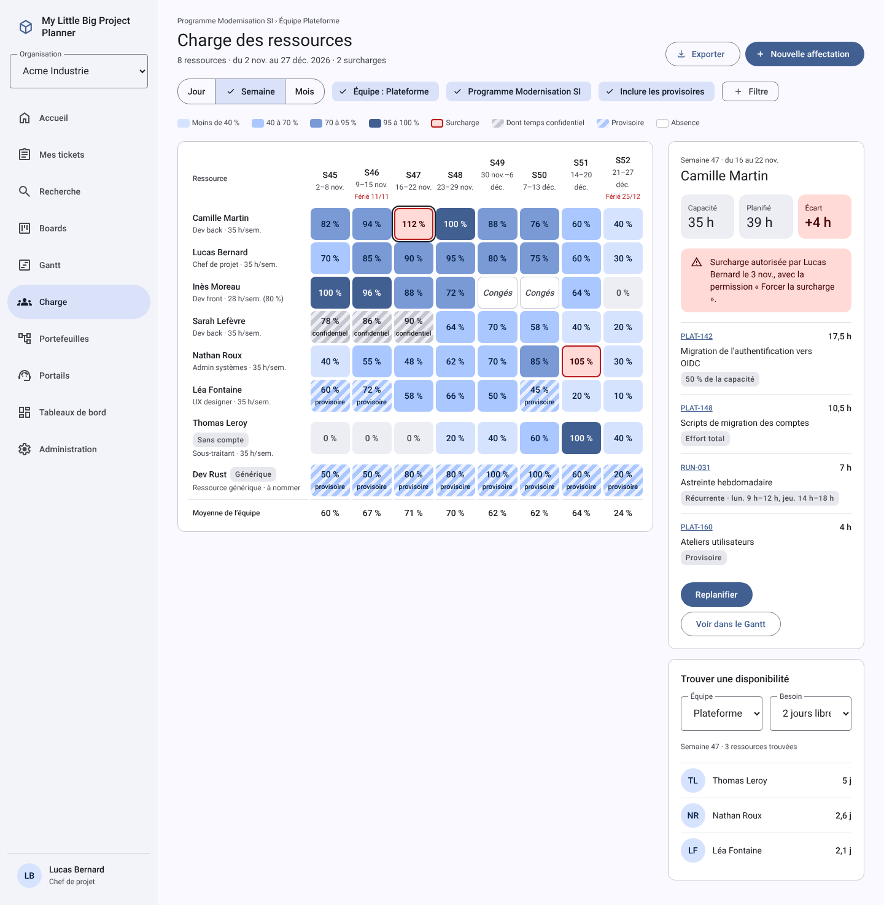

# My Little Big Project Planner

[English](README.md) · **Français**

Un outil open source de gestion de projets et de tickets, sous licence MIT.

- **Paramétrage personalisable** : types de tickets, champs personnalisés, workflows et écrans, partagés entre projets.
- **Portails de demande** pour les utilisateurs internes, les clients et les fournisseurs, avec dépôt anonyme possible.
- **Portefeuilles, programmes et projets** dans une hiérarchie multi-parent, avec des agrégats qui ne comptent jamais deux fois le même projet.
- **Planification** : Gantt multi-projets, boards Kanban et Scrum, sprints, versions.
- **Gestion fine de la charge** : affectation en pourcentage, en heures par jour ou en effort total, sur plusieurs périodes ; contrôle de la capacité journalière ; tâches récurrentes.
- **API REST et serveur MCP** pour que les assistants IA travaillent sur vos projets, toujours avec les droits de l’utilisateur.

> **État** : phase de spécification et de conception. Le dépôt reste privé pendant l’usage interne et sera rendu public à l’ouverture du projet.

## Stack

Angular en Material Design 3 · Rust (Axum, SQLx, Tokio) · PostgreSQL · Docker Compose, prêt pour la scalabilité horizontale.

## Documentation

| Document | Contenu |
| --- | --- |
| [Spécification technico-fonctionnelle](docs/fr/specification.md) | Décisions, modèle de données, architecture, API, MCP, exigences non fonctionnelles, découpage en lots et planning du MVP |
| [Spécification, PDF](docs/fr/specification.pdf) | Le même document, avec les schémas d’architecture et de planning d’origine |
| [Maquettes](docs/mockups/README.fr.md) | 25 écrans couvrant le périmètre du MVP |
| [CLAUDE.md](CLAUDE.md) (anglais) | Règles de développement pour Claude Code et les contributeurs |

Toute la documentation existe aussi en anglais : [spécification](docs/en/specification.md) et [maquettes](docs/mockups/README.md). La spécification française est l’originale ; l’anglaise en est la traduction.

## Licence

[MIT](LICENSE)
