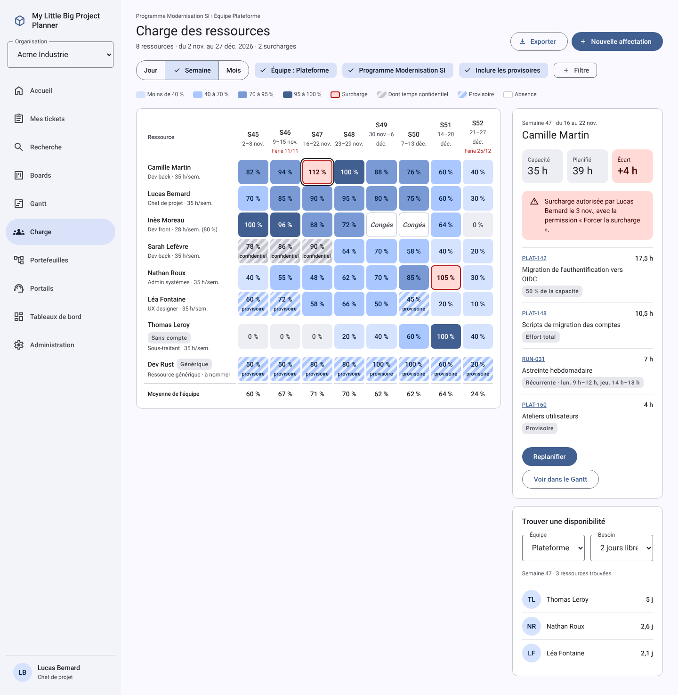

# My Little Big Project Planner

**English** · [Français](README.fr.md)

An open source project and ticket management tool, licensed under MIT.

- **Jira-like configuration**: issue types, custom fields, workflows and screens, shared between projects.
- **Request portals** for internal users, customers and suppliers, with optional anonymous submission.
- **Portfolios, programs and projects** in a multi-parent hierarchy, with aggregates that never count a project twice.
- **Planning**: Gantt charts across projects, Kanban and Scrum boards, sprints, versions.
- **Fine-grained workload**: assign people by percentage, hours per day or total effort, over several periods; daily capacity checks; recurring tasks.
- **REST API and MCP server** so AI assistants can work with your projects, always with the user's own permissions.

> **Status**: specification and design phase. The repository is private during internal use and will be made public when the project opens.

## Stack

Angular with Material Design 3 · Rust (Axum, SQLx, Tokio) · PostgreSQL · Docker Compose, ready for horizontal scaling.

## Documentation

| Document | Content |
| --- | --- |
| [Functional and technical specification](docs/en/specification.md) | Decisions, data model, architecture, API, MCP, non-functional requirements, MVP work packages and schedule |
| [Mockups](docs/mockups/README.md) | 25 screens covering the MVP scope (interface in French) |
| [CLAUDE.md](CLAUDE.md) | Development guidelines for Claude Code and for contributors |

All documentation is available in French: [specification](docs/fr/specification.md) (also as [PDF](docs/fr/specification.pdf), with the original diagrams) and [mockups](docs/mockups/README.fr.md). The French specification is the original; the English one is its translation.

## License

[MIT](LICENSE)
