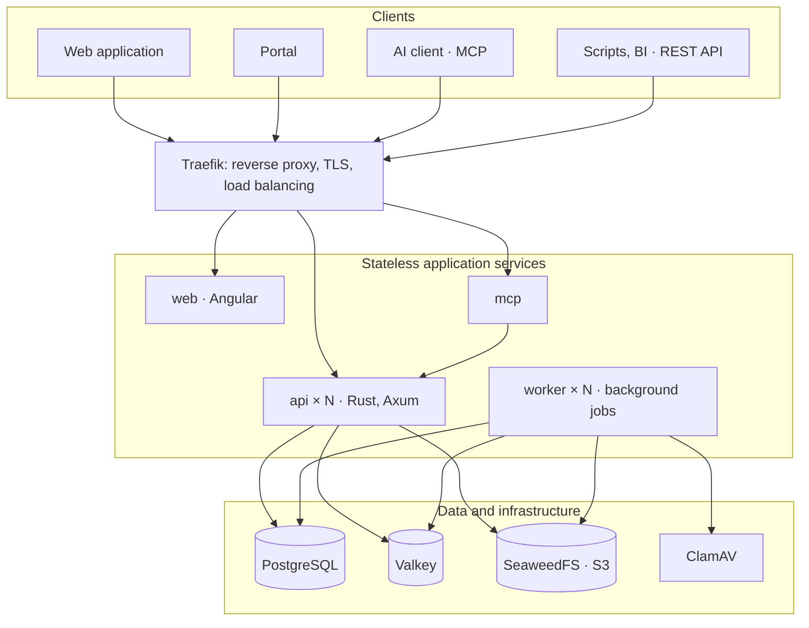

# Functional and Technical Specification — My Little Big Project Planner

**English** · [Français](../fr/specification.md)

Version of 8 November 2026 · Jérémy

## 1. Context and goals

My Little Big Project Planner is an open source (MIT) project and ticket management tool. It combines the configuration flexibility of Jira, the portals of Jira Service Management, the portfolios, programs and Gantt charts of OpenProject, and fine-grained resource workload management. An MVP usable internally is delivered in 8 months, before the public opening.

**Guiding principles**

- **Fully open**: MIT license, no open core model. Dependencies are only MIT, Apache-2.0 or BSD, which the CI checks automatically.
- **Internal use first**: the code lives in a private GitHub repository, made public at the opening. It is written in English and contains no internal references.
- **Multi-tenant by design**: deployed with a single tenant by default; multi-tenant mode is enabled by configuration.
- **Horizontally scalable**: stateless services, configuration through environment variables, no cloud-provider-specific service.
- **Few components**: every added service must be justified, for a team still learning Rust.

**Scope**

| Parameter | Value |
| --- | --- |
| Internal users at 3 years | 10,000 named, 1,000 concurrent |
| External users (portals) | 10,000 |
| Projects | several thousand |
| Tickets | several hundred thousand |
| Attachments | 5 MB on average, 1 per 3 tickets, i.e. 0.5 to 1 TB at 3 years |
| Team | 4 developers: 1 experienced in Rust, 3 beginners; all 4 know Angular |
| MVP deadline | 8 months |
| Stack | Angular, Rust (Axum), PostgreSQL, Docker Compose |
| Hosting | on-premises or cloud |

## 2. Summary of decisions

This table summarizes the choices made during scoping; the following sections detail them.

| Area | Decision |
| --- | --- |
| License | MIT, fully open, no GPL or AGPL dependency linked to the code |
| Tenants | `tenant_id` everywhere and isolation through PostgreSQL Row-Level Security; single tenant by default |
| Accounts | Global account, member of one or more tenants |
| Hierarchy | Multi-parent graph; portfolio → portfolio, program, project; program → program, project; project → project; root allowed |
| Aggregates | Over all distinct descendants, optional weighting per link |
| Hierarchical permissions | Roles inherited downwards, union in multi-parent, inheritance can be blocked, confidential projects counted anonymously |
| Tickets | Only in projects; a ticket belongs to a single project |
| Configuration | Single, shareable project configuration (types, fields, workflows, screens, notifications) |
| Query language | JQL-like, compiled to parameterized SQL, used everywhere |
| Agile | Kanban, Scrum, sprints, burndown, velocity, versions in the MVP; points or hours per board |
| Gantt | In-house, virtualized; finish-to-start dependencies with lag; manual scheduling |
| Workload | Assignments in segments (%, h/day, total effort), load stored per day in minutes, overload blocked by default |
| Resources | People (with or without an account) and generic resources; equipment and rooms after the MVP |
| Recurrences | RRULE, occurrences materialized over 90 days, future load computed, optional fixed time slot |
| Portal | In the MVP, for all audiences, anonymous access can be enabled per portal |
| Languages | FR and EN in the MVP, translatable configuration labels, time zones handled |
| Accessibility | RGAA 4 / WCAG 2.1 AA |
| GDPR | Anonymization on request, unlimited retention of business data, limited technical logs |
| Import | Jira and OpenProject after the MVP; current state, comments, attachments, time |
| Front end | Angular |
| Back end | Rust: Axum, Tokio, SQLx, utoipa |
| API | Versioned REST, generated OpenAPI, no GraphQL |
| MCP | Separate Rust service, Streamable HTTP, OAuth 2.1, user's permissions |
| Deployment | Docker Compose on one machine for the MVP; Helm/Kubernetes later |
| Code | Private GitHub repository, made public at the opening; portable GitHub Actions CI |
| MVP | 8 months, work packages classified as essential / important |

## 3. Tenants and identities

A tenant is an isolated organization; a user account is global and can belong to several tenants.

**Tenants**

- Every business table has a `tenant_id`. PostgreSQL enforces isolation with Row-Level Security: a query never sees another tenant's rows, even if the application has a bug.
- The tenant is resolved by subdomain (`acme.example.org`). In single-tenant mode, one domain is enough.
- Uniqueness constraints include the tenant: a project key (`PROJ`) is unique per tenant.
- Each tenant has its default language and time zone, default working capacity, overload tolerance and quotas (storage, API rate).
- A tenant can be exported or deleted as a whole (portability, GDPR).

**Accounts and memberships**

- The account table is the only business table without a `tenant_id`. A membership table links it to tenants, with the account type and roles specific to each.
- Account types per tenant: internal, or external (portal only). An external account never reaches the internal application, whatever its role. The API checks this on every request.
- The authentication policy is defined per tenant: a tenant can require its SSO or MFA. Users authenticate according to the policy of the tenant they enter.
- A session holds a single tenant at a time. API and MCP tokens are issued for a given tenant. The interface offers a tenant switcher.

**Administration**

| Level | Role |
| --- | --- |
| Platform | Super admin: creates and deletes tenants, erases a global account, supervision |
| Tenant | Tenant admin: members, roles, configurations, portals, authentication policy |
| Tenant | Configuration admin: workflows, types and fields, without member management |
| Node | Node admin: members and roles of the node and its descendants, creation of child projects |

## 4. Portfolio, program and project hierarchy

The hierarchy is a directed acyclic graph: a node can have several parents, within the limits of the matrix below.

| Child type | Allowed parents |
| --- | --- |
| Portfolio | Portfolio |
| Program | Portfolio, Program |
| Project | Portfolio, Program, Project |

**Rules**

- A node can be at the root, without a parent.
- A node cannot become its own ancestor: the database rejects any link that would create a cycle.
- The matrix is checked by the API and by a database constraint.
- Only projects hold tickets. Portfolios and programs have their own description, owners, dates, status, objectives (and budget after the MVP). A program is steered through a "Steering" project placed under it.
- An archived project becomes read-only and leaves the active lists and aggregates. Project templates come after the MVP.

**Aggregates**

- A node aggregates over all its distinct descendant projects. A project reached through two paths is counted once.
- Each parent-child link has an optional weighting (100% by default), for budget allocations.
- Computed aggregates: planned load, consumed capacity, progress (by status category), number of open and late tickets.
- Aggregates are precomputed by a worker and updated within seconds after each change.

**Permissions in the graph**

- A role granted on a node applies to all its descendants.
- With multiple parents, access is the union of the roles inherited from every parent and the direct roles. Permissions are always additive, with no explicit denial.
- A node can block inheritance (confidential project): only its direct members can access it.
- A confidential project is still counted in its ancestors' aggregates, without name or detail. In the heatmap, its time appears as "Busy (confidential)".

**Implementation**

A single `node` table (type: portfolio, program, project), a `node_edge` table (parent, child, weighting) and a `node_closure` closure table (ancestor, descendant, number of paths). The closure table makes descendant lookups, permission inheritance and cycle detection instantaneous.

## 5. Tickets and project configuration

All of a project's configuration lives in a single "project configuration", shareable between several projects. It replaces Jira's six kinds of schemes.

**Contents of a project configuration**

- **Issue types**, with their hierarchy: for example Epic, then Story, then Task, then Sub-task. Depth is defined by the types.
- **Fields**: system and custom fields, with visible / required rules per type and per workflow step.
- **Workflows**, one per issue type.
- **Screens**: creation, view, transition.
- **Notifications**: which events notify whom.

Permissions are not part of the configuration: they go through roles (section 14).

**Sharing and changes**

- Changing a shared configuration first shows the list of affected projects.
- A project can detach by duplicating its configuration.
- Changing a workflow or a configuration opens a status and type mapping wizard ("In test" becomes "In acceptance"), which migrates the affected tickets in the background.
- All labels (statuses, types, fields, list values) are stored as multilingual JSONB, with a fallback language.

**Custom field types**

| In the MVP | After the MVP |
| --- | --- |
| Short text, rich long text, number, checkbox, date, date-time, single select, multi-select, cascading select, user(s), group, labels, URL, link to a ticket | Calculated field (formula), field fed by an external reference list |

Custom field values are stored in a JSONB column of the ticket, with a GIN index. This makes filtering on several fields at once fast.

**Workflows (MVP)**

- Statuses fall into three categories: To do, In progress, Done. These categories feed aggregates, boards and burndown, whatever the labels.
- Table-based editing (statuses, transitions), with a read-only graphical view.
- Conditions: transition restricted to certain roles or groups.
- Validators: field required at transition.
- Post-functions: assign, set or clear a field, add a comment.
- Optional transition screen.

After the MVP: drag-and-drop graphical editor, advanced conditions, automations.

**Tickets**

- Readable key `PROJ-123`, unique per tenant. It is kept as an alias if the ticket moves to another project.
- A ticket belongs to a single project. It can be moved and linked to tickets of other projects: blocks, depends on, duplicates, relates to.
- Each ticket carries a version number, which prevents one change from silently overwriting another.
- A mapping table for external identifiers exists from the MVP, so the Jira and OpenProject import can be plugged in later without migration.

## 6. Search, query language, boards and agile

A single query language, inspired by JQL, powers search, filters, boards, the Gantt chart, dashboards, the API and MCP.

**Query language (MVP)**

| Element | Example |
| --- | --- |
| Comparisons | `priority = high`, `points > 3`, `status IN (todo, in_progress)`, `assignee IS EMPTY` |
| Logic | `AND`, `OR`, `NOT`, parentheses |
| Text | `text ~ "outage"` |
| Relative dates | `created > -7d`, `due < endOfWeek()` |
| Current user | `assignee = currentUser()` |
| Hierarchy | `project IN descendantsOf("PORTF-HR")` |
| Agile | `sprint IN openSprints()`, `fixVersion = "2.1"` |
| Sorting | `ORDER BY priority DESC, due ASC` |

- The query is parsed, then compiled to parameterized SQL: no injection is possible. Permissions and RLS always apply.
- It relies on stable identifiers (`in_progress`), never on translated labels.
- The interface offers a visual builder that generates the query, and an editor with autocompletion.
- Filters can be saved, personal or shared.
- Full-text search: PostgreSQL (`tsvector` and `pg_trgm`), behind an abstraction that will allow a dedicated engine later.
- After the MVP: history operators (`status WAS`, `CHANGED`) and link functions (`linkedTo()`).

**Boards (MVP)**

- **Kanban**: columns mapped to one or more statuses, fed by a filter, work-in-progress limits, swimlanes by assignee or epic.
- **Scrum**: backlog, sprint planning and closing (unfinished tickets move to the next sprint or the backlog), active sprint board.
- **Estimation**: points or hours, configurable per board. Workload always stays in hours, through assignments.
- **Reports**: burndown (in points or hours, based on remaining work), velocity over the last N sprints.
- **Versions and releases**: per project, with release date, status and release notes generated from the tickets.
- **Epics**: an issue type, with its progress bar.

**Exports**

CSV (essential) and Excel from any list view, with the displayed columns.

## 7. Planning, Gantt and calendars

The Gantt chart is built in-house: no commercial or GPL library is compatible with the MIT license, and the free alternatives are too limited.

**Gantt (MVP)**

- Fed by a query: a project, a program or a portfolio through `descendantsOf`. Tickets are grouped by project, with a summary bar per project; a project reached twice appears only once.
- Bars for dated tickets, diamonds for milestones. Drag-and-drop editing (move, resize) and dependency creation with the mouse.
- Finish-to-start dependencies, with positive or negative lag, including across projects.
- Manual scheduling: a violated dependency is shown in red, with an alert. Moving a task offers to shift its assignments.
- Scales: day, week, month, quarter.
- Virtualized rendering: only visible rows are drawn. Target: 5,000 rows with smooth scrolling.
- Accessibility: keyboard navigation and an equivalent table view.

**After the MVP**: start-to-start, finish-to-finish and start-to-finish dependencies; automatic scheduling; critical path and slack; baselines; PDF and image export; MS Project XML exchange.

**Calendars (MVP)**

- **Tenant calendar**: default working days and public holidays.
- **Site or country calendars**: preloaded public holidays (France first, then other countries), editable.
- **Resource calendar**: attached to a site, with its own exceptions.
- Planning dates are local dates (`date`), not UTC instants. This prevents a Monday task from moving to Sunday for a user in another time zone.

After the MVP: a project-specific calendar.

## 8. Resources and workload

A resource can combine several tasks on the same day as long as the sum of its assignments does not exceed its capacity for that day. By default, this check is blocking.

**Resources**

- An entity separate from the user account, with an extensible type:
  - **Person**: linked to an account, or without an account (a subcontractor who never logs in).
  - **Generic resource**: an unnamed role ("Rust developer"), replaceable later by a person. Replacement transfers the assignments.
  - **Equipment, room, object**: after the MVP, with the same capacity and assignment mechanisms.
- Teams group resources for views and filters. Assignments always target a resource, never a team.

**Capacity**

- Weekly pattern: hours per weekday (for example Monday 7 h, …, Friday 3.5 h), which covers part-time work.
- Historized with effective dates (switch to 80% on 1 March).
- Default value defined per tenant, for example 7 h × 5 days.
- Capacity of a day = weekly pattern, minus the site's public holidays, minus absences.
- Capacity is the maximum daily load. An overload tolerance can be configured per tenant (0% by default).

**Assignments**

An assignment links a resource to a ticket. It is made of one or more successive segments, each with its own period and mode.

| Mode | Example | Load on a given day |
| --- | --- | --- |
| Percentage | 50% from 3 to 14 March | % × actual capacity of the day (50% of a 3.5 h Friday = 1.75 h; public holiday = 0) |
| Hours per day | 2 h/day from 3 to 14 March | fixed hours, on working days |
| Total effort | 40 h between 3 and 28 March | effort spread evenly over working days |

- Multi-segment example: 4 h/day in week 1, then 2 h/day in week 2, on the same ticket.
- Segments must stay within the ticket's dates.
- Several resources can be assigned to the same ticket, each with its own independent assignment. The ticket's load is the sum of its assignments.
- An assignment can be marked "provisional": hatched in the heatmap, and counted or not in the overload check depending on a tenant setting.
- To book someone on a project without a specific task, create a "Project activity" ticket.
- After the MVP: distribution profiles (front-loaded, custom), MS Project modes (fixed units, fixed work, fixed duration), skills, resource request workflow.

**Storage and computation**

- Segments are the source of truth. The system derives one row per resource and per day (`resource_day_load`: local date, minutes, ticket, provisional flag), recomputed whenever a segment, capacity or absence changes.
- This table is partitioned by period. Precomputed aggregates per week, per month and per hierarchy node feed the views.
- Granularity: the day, stored in minutes. Time slots belong to the time-slot booking layer (section 9).

**Overload check**

- When an assignment is written, the system compares the resulting load of each day with capacity plus tolerance.
- Blocking mode (default): the assignment is rejected and the message lists the conflicting days. Roles with the "Force overload" permission can override it; this is logged.
- Warning mode (tenant choice): the assignment is accepted and the overload is flagged.
- The check runs in a transaction, with a lock per resource: two project managers assigning the same person at the same time cannot exceed that person's capacity between them.
- The future load of recurring tasks is included (section 9).

**Absences**

- Entered in the tool (leave, training, half days), by the person or their manager. After the MVP: approval workflow, import from an HRIS or Exchange through the API.
- Percentage assignment: the load drops to 0 on the absence day, automatically.
- Hours-per-day or total-effort assignment: hours falling on the absence become a conflict, reported to the project manager ("7 h to reschedule on PROJ-42"). Nothing is shifted automatically.

**Views (MVP)**

- Heatmap of resources × days, weeks or months, colored by occupation rate. Clicking a cell shows the tickets behind it.
- Filters by team, by project, or by hierarchy node.
- Load compared with capacity, aggregated by team, program and portfolio.
- Availability search: "who has 3 free days next week in team X?".
- The MVP detects and reports overloads; rescheduling suggestions (leveling) come later, as does planned vs. actual comparison.

## 9. Recurring tasks and time-slot bookings

A recurring task is a series that serves as a template for occurrences, each of them a real ticket. Its future load counts in the workload, even for occurrences not yet created.

**Recurrence rule**

- RRULE standard (RFC 5545), entered through a simple form: daily, weekly on certain days, monthly (on the 15th, or the 2nd Tuesday), yearly, with an interval.
- End: on a date, after N occurrences, or never. Specific occurrences can be removed (exceptions).
- Non-working day: per series, the occurrence moves to the next working day, to the previous working day, or is removed.
- Computed in the series' time zone: daylight saving changes are handled.

**Series and occurrences**

- The series holds the title, fields, duration per occurrence (for example 3 h) and assigned resources.
- A worker creates occurrences in advance over a rolling window (90 days by default, configurable per tenant).
- Beyond that window, the load is computed from the series and included in the heatmap and in the overload check.
- When a series is created or changed, capacity is checked over its whole horizon, capped at 12 months for an endless series.

**Editing a series**

- Three choices: "this occurrence", "this and following", "all".
- Past or completed occurrences are never changed.
- An occurrence edited individually is detached from the series.

**Missed occurrence**

- By default, it stays open, marked "late", and its assignee is alerted.
- Per-series option: automatic closing as "not done" when the next occurrence is created.

**Time-slot bookings**

- A series can have a fixed time slot (Monday 9:00–12:00). Without one, the occurrence is a duration within the day, handled by the daily load.
- Time slots are managed by a dedicated booking layer: two overlapping slots for the same resource are a conflict.
- A slot also counts in the resource's daily load.
- In the MVP, this layer serves fixed-time recurrences. After the MVP, it will serve rooms and equipment, which are booked by slot.
- Storage: a `tstzrange` interval with a PostgreSQL exclusion constraint. Overlaps are thus impossible in the database, even with concurrent writes.

## 10. Time tracking

The MVP offers simple time logging on tickets. It feeds the burndown in hours and prepares the planned vs. actual comparison.

- **Logging** on a ticket: date, duration, comment, billable flag. Done by the person, or through the API and MCP.
- **Remaining work**: the resource re-estimates the remaining work on their tickets. The burndown in hours relies on it.
- **After the MVP**:
  - weekly timesheet and timer;
  - manager approval and period locking;
  - hourly rates per resource, role, project and period;
  - budget vs. actual and earned value;
  - export to an ERP or payroll.

## 11. Portal

The portal lets internal users, customers and suppliers submit and track requests. Accounts are preferred, but anonymous access can be enabled per portal.

**Visibility, set per portal**

| Mode | Who can access |
| --- | --- |
| Public | Everyone, including without an account (if anonymous access is enabled) |
| Authenticated | Any account, internal or external |
| Internal | Internal accounts of the tenant, through its SSO |
| Invitation only | Invited accounts: a specific customer or supplier |

**Accounts**

- Internal users use their usual global account, with no extra account.
- Customers and suppliers have an external account: sign-up by invitation or self-service, login with a password or a magic link.

**Anonymous access (disabled by default)**

- Email is required. The requester receives a signed tracking link, to view and comment on the ticket without an account.
- If they later create an account with the same verified email, their anonymous tickets are attached to it automatically.
- Abuse protection: self-hosted proof-of-work captcha under an MIT-compatible license, rate limiting per IP and per email, invisible honeypot field.

**Features (MVP)**

- One or more portals per tenant, each attached to a project.
- Request types, each with its form built from the project's fields (visible and required), translatable.
- Requesters see their tickets and their status (public label per status), and exchange through comments. Internal comments are never visible on the portal.
- Outgoing email notifications: acknowledgment, status change, new public comment.
- Customization: logo, colors, welcome text.
- Portal-specific quotas and rate limiting, so a support spike does not affect internal users.

**After the MVP**:

- a portal feeding several projects;
- ticket creation from incoming email;
- knowledge base;
- customer organizations;
- SLAs, approvals, satisfaction (CSAT);
- conditional forms;
- custom domain.

## 12. Collaboration, notifications, real time, history

Every change produces an event, written to an outbox table in the same transaction. This single stream feeds real-time updates, notifications, and later webhooks.

**Comments and rich content**

- Rich editor based on Tiptap (MIT). Content is stored as structured JSON and rendered server-side to sanitized HTML, which prevents code injection.
- `@person` mentions (notified), `PROJ-123` references turned into links.
- Internal or public comments (visible on the portal).

**Attachments**

- S3-compatible object storage. The database only keeps metadata: name, size, type, SHA-256 hash, author.
- Direct upload and download through presigned URLs: files never go through the API.
- Deduplication by hash.
- Asynchronous processing by the workers: antivirus (ClamAV), thumbnails and previews. A file can only be downloaded once scanned.
- Maximum file size configurable (50 MB by default), quota per tenant.

**Notifications**

- In the application and by email.
- Preferences per user and per event type.
- Optional daily digest.
- Aggregated across all tenants for a user, with a tenant filter.
- After the MVP: Teams and Slack, through webhooks.

**Real time**

- Tickets, boards, Gantt and heatmaps update when another user changes something. Transport: Server-Sent Events, or WebSocket if a bidirectional need arises.
- Broadcast between API instances through Valkey pub/sub.
- No simultaneous co-editing on tickets. It is reserved for knowledge base articles and the wiki, after the MVP (section 21). Version-number protection warns users if the ticket changed in the meantime.

**History**

- Field-by-field audit log: who, when, old and new value, origin (interface, API, MCP, import, system).
- Visible in the ticket's "Activity" tab. It feeds burndown and velocity.
- Table partitioned by month.

**After the MVP**: wiki or project documentation.

## 13. Reporting and dashboards

The MVP covers agile reports, workload and composable dashboards. BI tools connect through the API.

- **Dashboards**, personal or shared, made of gadgets:
  - filter results list;
  - counter;
  - bar or pie chart by field;
  - sprint burndown;
  - workload mini-heatmap;
  - "my tickets".
- **Standard reports**: burndown, velocity, workload heatmap, load and progress aggregates by program and portfolio.
- **BI**: through the API (cursor pagination, field selection). No direct database access, which would bypass tenant isolation.
- **After the MVP**:
  - cumulative flow, SLA, planned vs. actual;
  - gadgets added through extensions;
  - stable, per-tenant, read-only reporting views.

## 14. Security, permissions, authentication, GDPR

Permissions rely on roles granted on hierarchy nodes and inherited downwards. PostgreSQL RLS guarantees tenant isolation independently of the application code.

**Permission model**

- **Global roles**: platform super admin. Per tenant: tenant admin, configuration admin, internal user, external user.
- **Node roles**: defined by each tenant as sets of permissions. Example permissions: view, create a ticket, edit, comment, log time, assign resources, force an overload, manage sprints, manage members, administer the node.
- **Grants**: to users or groups, on a node. Inherited downwards, union in multi-parent, can be blocked (section 4).
- **In the MVP**: restricted visibility on the portal (requesters only see their own tickets), internal or public comments, confidential projects.
- **After the MVP**: per-ticket security levels and field-level security.
- **Computation**: a user's effective permissions on a node are computed through the closure table and cached in Valkey, with event-based invalidation.

**Authentication**

| Mechanism | MVP | After the MVP |
| --- | --- | --- |
| Local accounts | Passwords hashed with Argon2id, reset by email |  |
| OIDC | Entra ID, Google, Keycloak, etc. |  |
| MFA | Authenticator app (TOTP) | Passkeys (WebAuthn) |
| Magic link | Portal |  |
| SAML, LDAP/AD | Through an optional Keycloak, which translates them to OIDC |  |
| Provisioning |  | SCIM |

**Application security**

- Front-end sessions through an `httpOnly`, `Secure`, `SameSite` cookie, with CSRF protection.
- Strict input validation, server-side HTML sanitization, security headers (CSP, HSTS).
- Rate limiting per user, token, IP and tenant.
- Secrets provided through environment variables or mounted files, never in the code. Automatic secret detection (gitleaks) in the CI.
- Dependency audit: `cargo-deny` (licenses and vulnerabilities) and `npm audit`.

**GDPR**

- **Retention**: unlimited for business data.
- **Technical logs** containing IP addresses: limited, configurable retention (6 months by default, in line with CNIL recommendations).
- **Erasure through anonymization**: name, email and avatar removed; the author appears as "Deleted user #1234" everywhere, history included. Content is kept, with an option to purge comments.
- **Who can erase**: a tenant admin removes a member; erasing the global account is up to the user or the super admin. Anonymous portal requesters can be erased by their email.
- **Right of access**: users can export their personal data as JSON.
- **Backups**: erased data remains in backups until they rotate, as the operations documentation states.

## 15. REST API

The public API is the one the front end uses: everything done in the interface goes through the API. It is REST, versioned (`/api/v1`), and its OpenAPI contract is generated from the Rust code (utoipa).

**Contract and clients**

- Published OpenAPI specification and interactive documentation served by the API.
- Typed Angular client generated from the contract, which prevents the front end and back end from drifting apart.
- Compatibility guaranteed within a major version: additions are allowed, removals go through an announced deprecation.

**Authentication**

| Use | Mechanism |
| --- | --- |
| Web front end | Secure cookie session |
| Scripts, integrations | Personal tokens with scopes and expiry |
| Tenant automations | Service accounts |
| Third-party applications, MCP | OAuth 2.1 (authorization code + PKCE) through the built-in authorization server |

Fine-grained scopes, for example: `tickets:read`, `tickets:write`, `workload:read`, `workload:write`, `time:write`, `admin`.

**Conventions**

- Cursor pagination, `expand` to include relations, selection of returned fields.
- Search through the query language: `POST /api/v1/search` with `{query, fields, expand, cursor}`.
- Lost-update protection: `ETag` and `If-Match`.
- Idempotency key on creations (`Idempotency-Key`): replaying a request does not create a duplicate.
- Errors in RFC 9457 format (Problem Details), with stable codes translated on the client side.
- Labels returned in the language of the `Accept-Language` header, all translations available on request.
- Bulk operations (edit, transition, move): synchronous up to 100 items, in the background beyond that, with tracking.
- Rate limiting per token and per tenant, with `RateLimit-*` headers.

**Resource families (MVP)**

- Tenants, members, service accounts, tokens
- Hierarchy nodes, links and aggregates
- Project configurations, types, fields, workflows, screens
- Tickets, comments, attachments, links, history
- Search and saved filters
- Boards, sprints, versions
- Resources, teams, capacities, calendars, absences
- Assignments, load, availability
- Recurring series, time-slot bookings
- Time entries
- Portals, request types
- Dashboards
- Notifications and preferences

**After the MVP**: webhooks plugged into the outbox, with query filters, HMAC signatures, retries with backoff and replay. Native integrations (Git, iCal, Teams, Slack) and WASM extensions will build on the API and webhooks.

## 16. MCP server

The MCP server is a separate, thin Rust service built on the official MCP SDK for Rust. It exposes the tool to AI assistants by calling the public API, always on behalf of the user and with exactly their permissions.

**Architecture**

- Streamable HTTP transport, remote deployment.
- OAuth 2.1 authentication through the built-in authorization server, compliant with the MCP specification. An MCP token is valid for a single tenant.
- No business logic of its own: every rule (permissions, overload check) is enforced by the API.
- Every change made through MCP is marked "via MCP" in the history.

**Tools (MVP)**

| Tool | Type | Purpose |
| --- | --- | --- |
| `search_tickets` | read | Search with the query language |
| `get_ticket` | read | Ticket details, comments, links, assignments |
| `browse_hierarchy` | read | Portfolios, programs, projects and their aggregates |
| `get_resource_load` | read | Load and capacity of a resource or team over a period |
| `find_availability` | read | Resources with N free hours or days over a period, by team |
| `list_options` | read | Types, statuses, transitions and fields available for a project |
| `create_ticket` | write | Create a ticket |
| `update_ticket` | write | Edit fields |
| `transition_ticket` | write | Change status according to the workflow |
| `add_comment` | write | Internal or public comment |
| `log_time` | write | Log time |
| `assign_resource` | write | Create an assignment, subject to the overload check |

- Tools are annotated according to the MCP specification (read-only or modifying), so the AI client asks the user for confirmation before writing.
- No deletion or administration (configurations, roles, tenants) through MCP in the MVP.
- Responses are compact and paginated, so as not to saturate the model's context.

## 17. Technical architecture

Four stateless application services run behind Traefik, on PostgreSQL, Valkey and S3 object storage. To scale out, add `api` and `worker` instances.

*Optional: Keycloak (SAML, LDAP), Prometheus, Grafana, Loki.*

The browser uploads and downloads attachments directly to and from object storage, through presigned URLs provided by the API.

**Services**

| Service | Role | Scaling |
| --- | --- | --- |
| `web` | Angular front end (internal application and portal), static files served by nginx | Replicable |
| `api` | REST API, sessions, OAuth server, real-time stream | Horizontal, stateless |
| `worker` | Job queue: recurring occurrences, load aggregates, notifications and emails, antivirus, thumbnails, workflow migrations, bulk operations | Horizontal: `SKIP LOCKED` guarantees each job is processed once |
| `mcp` | MCP server | Horizontal |
| PostgreSQL | Data, RLS, job queue, outbox | Vertical; read replicas and Patroni after the MVP |
| Valkey (BSD) | Cache, sessions, rate limiting, real-time pub/sub | Single instance; Sentinel later |
| SeaweedFS (Apache-2.0) | File storage, S3 API | Multi-node possible, or any external S3 |
| ClamAV | Antivirus scanning of attachments | Single instance |
| Traefik (MIT) | Reverse proxy, TLS, instance discovery | Single instance |

**Rust back end**

- Libraries: Axum, Tokio, SQLx, serde, utoipa, tracing, OpenTelemetry.
- Cargo workspace:
  - `domain`: business rules (capacity, load, recurrences, workflows, query language), with no technical dependency, tested without a database;
  - `infra`: PostgreSQL, S3 storage, email, Valkey;
  - `api`, `worker`, `mcp`: one binary per service.
- The shared foundation sets the tenant context on every request (`SET LOCAL` of the variable read by RLS): a developer cannot forget it.

**Angular front end**

- Recent Angular: standalone components, signals, no zone.js.
- One workspace with two applications (internal, portal) and shared libraries: generated API client, components, translations.
- Material Design 3 interface with Angular Material and the CDK (MIT). The theme is generated from a seed color, through M3 system tokens: color roles, typography, shapes. Dark mode comes at no extra cost. Material Symbols icons (Apache-2.0), Roboto font (OFL). In-house components (Gantt, heatmap, board) use only these tokens, to stay consistent with the rest of the interface. Each portal generates its own M3 scheme from its brand color, with material-color-utilities (Apache-2.0).
- Gantt and heatmap drawn on canvas for performance, with an accessible keyboard layer on top.

**Scalability**

- **Horizontal**: `docker compose up --scale api=3 --scale worker=2`; Traefik discovers the instances. Sessions live in Valkey, files in S3, real time goes through Valkey: any instance can serve any user.
- **Vertical**: PostgreSQL is the first contention point. Heavy views (heatmap, aggregates) read precomputed tables. A pooler (PgBouncer) is added if the number of instances justifies it.
- **Moving to Kubernetes** without code changes: configuration through environment variables, health endpoints, graceful shutdown, migrations run as a separate job.

**Docker Compose**

- A single file, with profiles: by default all the services above; `sso` adds Keycloak; `observability` adds Prometheus, Grafana and Loki.
- Persistent volumes for PostgreSQL and SeaweedFS; scheduled pgBackRest backups.
- The same file serves development (with a local override) and single-machine production.

## 18. Data model

The model is relational, with JSONB for custom fields and translated labels. Every business table has `tenant_id` and is protected by RLS, except `account`.

**Conventions**

- UUID v7 primary keys: time-sortable, generated by the application, suited to future partitioning and imports.
- `created_at`, `updated_at` columns as `timestamptz` (UTC), and `version` for optimistic concurrency.
- Planning dates as local `date`; time slots as `tstzrange`.
- Translatable labels as JSONB `{"fr": …, "en": …}`.
- Versioned SQLx migrations, applied at API startup or by a dedicated command.

**Main entities**

| Area | Tables | Key points |
| --- | --- | --- |
| Identity | `account`, `tenant`, `membership`, `group`, `group_member`, `api_token`, `oauth_client` | `account` outside RLS; authentication policy per tenant |
| Hierarchy | `node`, `node_edge`, `node_closure`, `node_role_grant` | Attachment matrix, cycle prevention, weighting on `node_edge` |
| Configuration | `project_config`, `issue_type`, `field_def`, `field_rule`, `workflow`, `workflow_status`, `workflow_transition`, `screen` | One configuration shared by N projects |
| Tickets | `issue`, `issue_link`, `comment`, `attachment`, `external_ref`, `issue_key_alias` | Custom fields as GIN-indexed JSONB |
| Agile | `board`, `board_column`, `sprint`, `sprint_issue`, `version` | Sprint history for velocity |
| Search | `saved_filter` | Queries stored on stable identifiers |
| Resources | `resource`, `team`, `team_member`, `capacity_pattern`, `calendar`, `calendar_exception`, `absence` | Capacity historized by effective dates |
| Workload | `assignment`, `assignment_segment`, `resource_day_load`, `load_aggregate`, `time_slot` | Daily load derived from segments; `time_slot` with an exclusion constraint |
| Recurrences | `recurring_series`, `series_assignment` | RRULE, time zone, materialization window |
| Time | `time_entry`, `remaining_estimate` | Billable flag |
| Portal | `portal`, `request_type`, `anonymous_requester` | Signed tracking link |
| Collaboration | `notification`, `notification_pref`, `dashboard`, `gadget` |  |
| Events | `outbox_event`, `job` | `SKIP LOCKED` job queue |
| Audit | `audit_log` | Field by field, origin of the change |

**Volume and partitioning**

- Partitioned by month from the start: `audit_log`, `resource_day_load`, `notification`, `outbox_event` (purged after processing), technical logs.
- Tickets, nodes and comments (a few hundred thousand to a few million rows) do not need partitioning.
- Composite indexes starting with `tenant_id` on all high-volume tables.

## 19. Non-functional requirements

The targets below are checked by automated load and accessibility tests before the MVP goes into production.

**Performance**

| Measure | Target |
| --- | --- |
| API reads (95th percentile) | < 200 ms |
| Writes with load check (95th percentile) | < 500 ms |
| Initial interface load | < 2 s |
| Heatmap of 200 resources over 3 months | < 1 s |
| Gantt | 5,000 rows, smooth scrolling |
| Aggregate update after a change | a few seconds |
| Concurrent users | 1,000 |

**Availability and backups**

- Target availability for internal MVP use: 99.5%.
- PostgreSQL backed up with pgBackRest (MIT), with point-in-time recovery. Maximum data loss: 15 minutes. Recovery time: under 4 hours.
- Files backed up separately, through object storage replication or versioning. The restore procedure guarantees consistency between the database and the files.
- MVP production on a single machine: restores are tested and timed regularly, complemented by VM snapshots if the hypervisor allows it.
- After the MVP: PostgreSQL high availability (Patroni, read replicas) and Kubernetes.

**Accessibility and languages**

- RGAA 4 / WCAG 2.1 level AA; axe-core tests in the CI; Gantt and heatmap keyboard-navigable with an equivalent table view.
- Translations loaded at runtime (Transloco, MIT), French and English in the MVP.
- Timestamps in UTC, displayed in the user's time zone.

**Observability**

- OpenTelemetry in the code (traces and metrics), structured JSON logs, with a correlation ID per request.
- Health endpoints: `/health/live` and `/health/ready`.
- Prometheus, Grafana and Loki provided in an optional compose profile. They are separate services: their license does not affect the MIT code.

**CI/CD and code**

- Private GitHub repository from the start, made public at the opening. Before that, the history is checked: no secrets, no internal references.
- Portable CI: every step is a `just` command, and GitHub Actions only calls them.
- Pipeline:
  - Rust: `cargo fmt`, `clippy`, unit and integration tests on a real PostgreSQL, `cargo-deny`.
  - Front end: lint, tests, axe-core.
  - End to end: Playwright.
  - Security: gitleaks.
  - Docker images built with their SBOM.
- Environments: development, acceptance, production.
- Repository in English: code, commits, documentation.

## 20. MVP work packages and schedule

The MVP is split into 17 work packages delivered over 8 months. The 13 essential packages gate the production release; the 4 important packages can slip just after it without blocking it.

| Package | M1 | M2 | M3 | M4 | M5 | M6 | M7 | M8 |
| --- | :-: | :-: | :-: | :-: | :-: | :-: | :-: | :-: |
| L01 Technical foundation | █ |  |  |  |  |  |  |  |
| L02 Identities, roles, permissions | █ | █ |  |  |  |  |  |  |
| L03 Hierarchy |  | █ |  |  |  |  |  |  |
| L04 Project configuration |  | █ | █ |  |  |  |  |  |
| L05 Tickets and collaboration |  | █ | █ | █ |  |  |  |  |
| L06 Search and Kanban |  |  | █ | █ |  |  |  |  |
| L07 Resources and capacity |  |  |  | █ |  |  |  |  |
| L08 Assignments, workload |  |  |  | █ | █ | █ |  |  |
| L09 Scrum and versions |  |  |  |  | ▒ |  |  |  |
| L10 Time tracking |  |  |  |  | ▒ |  |  |  |
| L11 Recurrences, time slots |  |  |  |  | █ | █ |  |  |
| L12 Gantt |  |  |  |  |  | █ | █ |  |
| L13 Portal |  |  |  |  |  | █ | █ |  |
| L14 Dashboards |  |  |  |  |  |  | ▒ |  |
| L15 Public API and OAuth |  |  |  |  |  |  | █ |  |
| L16 MCP |  |  |  |  |  |  | ▒ | ▒ |
| L17 Industrialization, acceptance |  |  |  |  |  |  |  | █ |
| **Internal production release** | | | | | | | | ◆ |

█ essential · ▒ important, can slip just after the MVP · ◆ milestone

The month 1 foundation gates everything else; workload (L07, L08, L11) is the core of the project, from months 4 to 6.

**Work packages**

| Package | Content | Level | Depends on |
| --- | --- | --- | --- |
| L01 Technical foundation | Rust workspace, database access and migrations, tenant context and RLS, error handling, reference endpoint, OpenAPI pipeline, Angular skeleton and theme, Docker Compose, CI, basic observability | Essential | — |
| L02 Identities, roles, permissions | Global accounts, tenants, memberships, local authentication, OIDC and MFA, groups, roles and permissions, administration | Essential | L01 |
| L03 Hierarchy | Nodes, multi-parent links, closure table, cycle prevention, permission inheritance, confidentiality, aggregates, archiving | Essential | L02 |
| L04 Project configuration | Types, custom fields, workflows, screens, translatable labels, sharing, migration wizard | Essential | L01 |
| L05 Tickets and collaboration | Tickets, links, comments, rich editor, attachments and antivirus, history, outbox, notifications, real time | Essential | L03, L04 |
| L06 Search and Kanban | Query language, full text, saved filters, Kanban board, CSV and Excel export | Essential (Excel: important) | L05 |
| L07 Resources and capacity | Resources, teams, capacity patterns, calendars and public holidays, absences | Essential | L02 |
| L08 Assignments, workload | Segments, daily load, overload check, heatmap, aggregates; availability and provisional booking | Essential (availability and provisional: important) | L05, L07 |
| L09 Scrum and versions | Backlog, sprints, Scrum board, burndown, velocity, versions and releases | Important | L06 |
| L10 Time tracking | Time logging, remaining work, billable flag | Important | L05 |
| L11 Recurrences, time slots | RRULE series, materialization, future load, series editing, time-slot bookings | Essential | L08 |
| L12 Gantt | Virtualized rendering, editing, dependencies, multi-project, accessibility; rendering prototype from M3 | Essential | L05, L08 |
| L13 Portal | Portals, request types, external accounts, anonymous access, tracking link, notifications, customization | Essential | L02, L04, L05 |
| L14 Dashboards | Dashboards and gadgets | Important | L06, L08, L09 |
| L15 Public API and OAuth | OAuth 2.1 server, tokens and service accounts, bulk operations, rate limiting, public documentation | Essential | L02, all functional packages |
| L16 MCP | MCP server and its 12 tools | Important | L15 |
| L17 Industrialization, acceptance | Load tests, security and isolation audit, accessibility, backups and tested restore, documentation, internal acceptance | Essential | all |

**Suggested team allocation**

- **Experienced Rust developer**: foundation (L01), load and recurrence engine (L08, L11), review of all Rust code.
- **Back-end developer 2**: identities, hierarchy, configuration, tickets, search (L02 to L06), then public API (L15).
- **Front-end developer 1**: theme and components, ticket and configuration screens, boards, portal (L13).
- **Front-end developer 2**: heatmap, Gantt (L12), dashboards, then MCP (L16) paired with the back end.

Everyone pairs on Rust during the first two months, so the skill does not rest on a single person.

**Validation milestones**

- **End of M1**: foundation validated (complete reference endpoint, tenant isolation tested, compose deployment).
- **End of M4**: demo of tickets, configuration, search and Kanban on real data.
- **End of M6**: complete workload, recurrences included.
- **End of M7**: feature freeze; unfinished important packages move after the MVP.
- **End of M8**: internal production release.

## 21. After the MVP and out of scope

Everything discussed that is not in the MVP makes up the roadmap, in no fixed order at this stage. The MVP data model already anticipates these evolutions.

| Area | Planned evolutions |
| --- | --- |
| Import | Jira and OpenProject (current state, comments, attachments, time; incremental imports) |
| Configuration | Graphical workflow editor, advanced conditions, automations, calculated fields and external reference lists |
| Search | History operators, link functions |
| Planning | SS / FF / SF dependencies, automatic scheduling, critical path, baselines, project calendar, PDF and MS Project exports |
| Workload | Equipment and rooms, skills, leveling, distribution profiles, MS Project modes, resource request workflow, absence approval and import |
| Time and costs | Timesheet, approval, locking, rates, budgets, earned value, ERP and payroll export |
| Portal | Several projects per portal, incoming email, knowledge base, customer organizations, SLA, approvals, CSAT, conditional forms, custom domain |
| Security | Per-ticket security levels, field-level security, passkeys, SCIM |
| Integrations | Webhooks, Git, iCal, Teams, Slack, WASM extensions |
| Reporting | Cumulative flow, SLA, planned vs. actual, per-tenant reporting views |
| Organization | Project templates, wiki |
| Operations | Helm chart, PostgreSQL high availability |

**Assets module (after the MVP)**

Modeled on Jira Service Management Assets, this module is a configurable object database (CMDB). It records everything the organization manages — workstations, servers, software, licenses, contracts, sites, suppliers — with their relationships, and links them to tickets.

- **Object schemas per tenant**:
  - hierarchical object types (Hardware, then Laptop), whose attributes are inherited from the parent type;
  - typed attributes: text, number, date, list, user, status, reference to another object.
- **References between objects**, typed ("installed on", "depends on", "belongs to"). They form a dependency graph, with an impact view: which services are affected if this server goes down?
- **Link with tickets**:
  - an "Object(s)" field type, filtered by a query;
  - a tab listing the tickets of each object;
  - on the portal, requesters pick from their own equipment.
- **Query language extended to objects**, the equivalent of Jira's AQL (`objectType = Laptop AND owner = currentUser()`). Usable in fields, filters, the API and MCP.
- **Import and synchronization**:
  - CSV, JSON and API, matched by external key;
  - later, discovery connectors (LDAP/AD directory, network inventory, cloud), run by the workers.
- **Lifecycle**: object statuses, field-by-field history, warranty and contract end dates with alerts.
- **Permissions**: roles per schema (view, edit, administer), and visibility rules on the portal.
- **Link with workload**: an equipment or room resource (section 8) can reference an Assets object. Inventoried equipment can thus be booked without double entry.
- **Data model**: `asset_schema`, `asset_type`, `asset_attribute_def`, `asset_object`, `asset_reference`, `issue_asset`.
  - Attributes are stored as GIN-indexed JSONB, like ticket custom fields.
  - The tables are protected by the same RLS.

Prepared in the MVP at almost no cost: the query language compiler is designed for several entity types, and the "link" field type is generic. The module will thus be added without a redesign.

**Knowledge base and FAQ module (after the MVP)**

Modeled on the Jira Service Management knowledge base, this module centralizes help content: articles, imported documents and FAQs. This content is suggested to requesters on the portal and to teams in tickets. It also covers the portal knowledge base and the project wiki listed in the table above.

- **Document spaces** per tenant, attachable to one or more portals and projects, organized in nested categories.
- **Articles**:
  - written in the rich editor (Tiptap), with images and attachments;
  - draft, review, published workflow;
  - versions with history and restore;
  - owner and review date, with a reminder when the article needs reviewing.
- **Imported documents**: PDF, Word, Markdown, HTML.
  - Stored in object storage, with antivirus.
  - Their text is extracted by the workers for search.
  - A document can be converted into an article.
- **FAQ**: question / answer pairs grouped by category, entered directly or extracted from an article or document, and shown on the portal.
- **Portal deflection**: while a request is being typed, relevant articles and FAQ answers are suggested. The rate of avoided requests is measured.
- **For teams**:
  - article suggestions in the ticket;
  - inserting an article link in a reply;
  - creating an article from a resolved ticket;
  - links between tickets and articles.
- **Visibility**: internal (teams), public on a portal (including anonymous access if the portal allows it), or restricted to a portal or a group.
- **Languages**: each article can have one version per language, falling back to the tenant's default language.
- **Search**:
  - PostgreSQL full text, multilingual;
  - optionally, semantic search through pgvector (PostgreSQL license, MIT-compatible), to find an article from a freely worded question.
- **Feedback and metrics**: "Was this article helpful?", view counts, most viewed articles, searches with no result. The latter show which articles to write.
- **API and MCP**: `search_knowledge` and `get_article` tools. An AI assistant can thus answer based on the documentation, always with the user's permissions.
- **Data model**: `kb_space`, `kb_category`, `kb_article`, `kb_article_version`, `kb_document`, `kb_faq_item`, `kb_feedback`, `issue_article`.
  - Tables protected by the same RLS.
  - Multilingual labels and content.

**Co-editing of articles**

Several people can edit the same article at the same time, seeing each other's cursors. Simultaneous changes merge automatically, even after a network outage.

- **Technology**: Tiptap's collaboration extension on the front end, and [Hocuspocus](https://github.com/ueberdosis/hocuspocus) (MIT) on the server. It is the Yjs synchronization server maintained by the Tiptap team.
- **`collab` service**: a new Node.js service, with no business state, like MCP. On connection and then regularly, it has permissions checked by the Rust API; it switches to read-only if the user may not edit.
- **Persistence**: the Yjs binary state is the reference during editing. On each save, the service produces a readable copy (JSON and HTML) sent to the API. This copy feeds search, the API, MCP and display.
- **History**: snapshot versions replace the field-by-field audit, taken every N minutes and when the editing session closes. They can be viewed and restored.
- **Scaling**: an open document lives in memory on one instance. Instances synchronize through Valkey, already in the stack.
- **To check**: the license of the advanced Tiptap extensions (anchored comments, history). If they are not MIT-compatible, they are built in-house.
- **Estimate**: 3 to 4 weeks for co-editing, persistence, permissions and cursors; about as much for versions and anchored comments.
- **Scope**: co-editing covers knowledge base articles and the wiki. Tickets do not get it (section 12).

**Out of scope, including after the MVP**

- Simultaneous co-editing of tickets (descriptions, comments): short texts, almost always written by one person, for which the version number is enough.
- GraphQL.
- Running user scripts on the server (only isolated WASM extensions are planned).
- Direct database access for BI.
- Docker Swarm.

## 22. Risks and points of attention

The main risk is the gap between an ambitious scope and a team new to Rust. The mitigations rely on a solid foundation in month 1 and on classifying work packages as essential or important.

| Risk | Impact | Mitigation |
| --- | --- | --- |
| Slower-than-expected Rust ramp-up | Delay on all back-end packages | Foundation and reference endpoint built by the experienced developer, "boring" Rust (few generics and macros), pairing, systematic review |
| In-house Gantt underestimated | Delay in month 6 | Start with a virtualized rendering prototype in month 3; MVP scope limited to finish-to-start dependencies and manual scheduling |
| Incorrect load computation (time zones, capacities, recurrences) | Loss of trust in the workload | Business rules isolated in the `domain` crate, tested without a database, with property-based tests on edge cases (DST changes, part time, public holidays) |
| Data leak between tenants | Serious incident | Database RLS, automated isolation tests on every endpoint, `tenant_id` enforced by the foundation |
| Contention on the overload check | Slow writes | Lock per resource, short transactions, aggregates recomputed in the background |
| Dependency under an incompatible license | Opening blocked | `cargo-deny` and npm license checks from the first commit |
| Production on a single machine | Downtime on failure | Restore tested and timed; design ready for Kubernetes |
| Scope creep during development | 8-month deadline unreachable | Every new request goes to the roadmap; only essential packages gate the production release |

**To be decided later**

- Public domain name of the project.
- Order of the post-MVP roadmap.
- Long-term production hosting target (Kubernetes or not).
