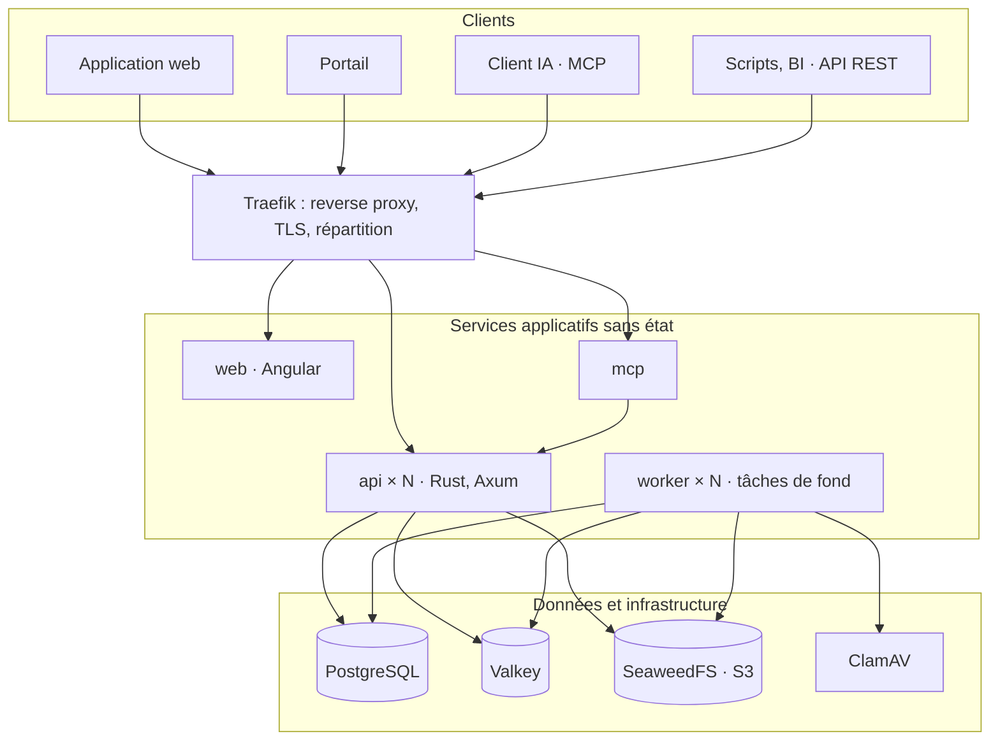

# Spécification technico-fonctionnelle — My Little Big Project Planner

[English](../en/specification.md) · **Français**

Version du 8 novembre 2026 · Jérémy

## 1. Contexte et objectifs

My Little Big Project Planner est un outil open source (licence MIT) de gestion de projets et de tickets. Il réunit la souplesse de paramétrage de Jira, les portails de Jira Service Management, les portefeuilles, programmes et Gantt d'OpenProject, et une gestion fine de la charge des ressources. Un MVP utilisable en interne est livré en 8 mois, avant l'ouverture publique.

**Principes directeurs**

- **Tout ouvert** : licence MIT, pas de modèle open core. Les dépendances sont uniquement sous MIT, Apache-2.0 ou BSD, ce que la CI vérifie automatiquement.
- **Usage interne d'abord** : le code vit dans un dépôt GitHub privé, rendu public à l'ouverture. Il est en anglais et ne contient aucune référence interne.
- **Multi-tenant dès la conception** : déployé avec un seul tenant par défaut, le mode multi-tenant s'active par configuration.
- **Scalable horizontalement** : services sans état, configuration par variables d'environnement, aucun service propre à un fournisseur cloud.
- **Peu de composants** : chaque service ajouté doit se justifier, pour une équipe qui monte en compétence sur Rust.

**Cadre**

| Paramètre | Valeur |
| --- | --- |
| Utilisateurs internes à 3 ans | 10 000 nommés, 1 000 simultanés |
| Utilisateurs externes (portails) | 10 000 |
| Projets | plusieurs milliers |
| Tickets | plusieurs centaines de milliers |
| Pièces jointes | 5 Mo en moyenne, 1 pour 3 tickets, soit 0,5 à 1 To à 3 ans |
| Équipe | 4 développeurs : 1 confirmé en Rust, 3 débutants ; les 4 connaissent Angular |
| Échéance du MVP | 8 mois |
| Stack | Angular, Rust (Axum), PostgreSQL, Docker Compose |
| Hébergement | on-premise ou cloud |

## 2. Synthèse des décisions

Ce tableau résume les choix arrêtés lors du cadrage ; les sections suivantes les détaillent.

| Domaine | Décision |
| --- | --- |
| Licence | MIT, tout ouvert, aucune dépendance GPL ou AGPL liée au code |
| Tenants | `tenant_id` partout et cloisonnement par Row-Level Security PostgreSQL ; mono-tenant par défaut |
| Comptes | Compte global, membre d'un ou plusieurs tenants |
| Hiérarchie | Graphe multi-parent ; portefeuille → portefeuille, programme, projet ; programme → programme, projet ; projet → projet ; racine autorisée |
| Agrégats | Sur l'ensemble des descendants distincts, pondération optionnelle par lien |
| Droits hiérarchiques | Rôles hérités vers le bas, union en multi-parent, blocage d'héritage possible, projet confidentiel compté anonymement |
| Tickets | Uniquement dans les projets ; un ticket appartient à un seul projet |
| Paramétrage | Configuration de projet unique et partageable (types, champs, workflows, écrans, notifications) |
| Langage de requête | Type JQL, compilé en SQL paramétré, utilisé partout |
| Agile | Kanban, Scrum, sprints, burndown, vélocité, versions dans le MVP ; points ou heures par board |
| Gantt | Maison, virtualisé ; dépendances fin-début avec décalage ; ordonnancement manuel |
| Workload | Affectations par segments (%, h/jour, effort total), charge stockée au jour en minutes, dépassement bloquant par défaut |
| Ressources | Personnes (avec ou sans compte) et ressources génériques ; équipements et salles après le MVP |
| Récurrences | RRULE, occurrences matérialisées sur 90 jours, charge future calculée, horaire fixe optionnel |
| Portail | Dans le MVP, tous publics, accès anonyme activable par portail |
| Langues | FR et EN au MVP, libellés de configuration traduisibles, fuseaux horaires gérés |
| Accessibilité | RGAA 4 / WCAG 2.1 AA |
| RGPD | Anonymisation à la demande, conservation illimitée des données métier, journaux techniques limités |
| Import | Jira et OpenProject après le MVP ; état actuel, commentaires, pièces jointes, temps |
| Front | Angular |
| Back | Rust : Axum, Tokio, SQLx, utoipa |
| API | REST versionnée, OpenAPI généré, pas de GraphQL |
| MCP | Service Rust séparé, Streamable HTTP, OAuth 2.1, droits de l'utilisateur |
| Déploiement | Docker Compose sur une machine pour le MVP ; Helm/Kubernetes après |
| Code | Dépôt GitHub privé, rendu public à l'ouverture ; CI GitHub Actions portable |
| MVP | 8 mois, lots classés indispensables / importants |

## 3. Tenants et identités

Un tenant est une organisation isolée ; un compte utilisateur est global et peut appartenir à plusieurs tenants.

**Tenants**

- Toutes les tables métier portent un `tenant_id`. PostgreSQL applique le cloisonnement par Row-Level Security : une requête ne voit jamais les lignes d'un autre tenant, même en cas de bug applicatif.
- Le tenant est résolu par sous-domaine (`acme.exemple.org`). En mode mono-tenant, un domaine unique suffit.
- Les contraintes d'unicité incluent le tenant : une clé de projet (`PROJ`) est unique par tenant.
- Chaque tenant a sa langue et son fuseau par défaut, sa capacité de travail par défaut, sa tolérance de surcharge et ses quotas (stockage, débit d'API).
- Un tenant peut être exporté ou supprimé en entier (portabilité, RGPD).

**Comptes et appartenances**

- La table des comptes est la seule table métier sans `tenant_id`. Une table d'appartenance la relie aux tenants, avec le type de compte et les rôles propres à chacun.
- Types de compte par tenant : interne, ou externe (portail uniquement). Un compte externe n'accède jamais à l'application interne, quel que soit son rôle. L'API le vérifie à chaque requête.
- La politique d'authentification est définie par tenant : un tenant peut imposer son SSO ou le MFA. L'utilisateur s'authentifie selon la politique du tenant dans lequel il entre.
- Une session porte un seul tenant à la fois. Les tokens API et MCP sont émis pour un tenant donné. L'interface propose un sélecteur de tenant.

**Administration**

| Niveau | Rôle |
| --- | --- |
| Plateforme | Super-admin : création et suppression de tenants, effacement d'un compte global, supervision |
| Tenant | Admin du tenant : membres, rôles, configurations, portails, politique d'authentification |
| Tenant | Admin de configuration : workflows, types et champs, sans gestion des membres |
| Nœud | Admin de nœud : membres et rôles du nœud et de ses descendants, création de projets enfants |

## 4. Hiérarchie portefeuilles, programmes, projets

La hiérarchie est un graphe orienté sans cycle : un nœud peut avoir plusieurs parents, dans les limites de la matrice ci-dessous.

| Type d'enfant | Parents autorisés |
| --- | --- |
| Portefeuille | Portefeuille |
| Programme | Portefeuille, Programme |
| Projet | Portefeuille, Programme, Projet |

**Règles**

- Un nœud peut être à la racine, sans parent.
- Un nœud ne peut pas devenir son propre ancêtre : la base refuse le lien qui créerait un cycle.
- La matrice est vérifiée par l'API et par une contrainte en base.
- Seuls les projets portent des tickets. Les portefeuilles et programmes ont en propre : description, responsables, dates, statut, objectifs (et le budget après le MVP). Le pilotage d'un programme se fait via un projet « Pilotage » placé sous lui.
- Un projet archivé passe en lecture seule et sort des listes et agrégats actifs. Les templates de projet viennent après le MVP.

**Agrégats**

- Un nœud agrège sur l'ensemble de ses projets descendants distincts. Un projet atteint par deux chemins est compté une fois.
- Chaque lien parent-enfant porte une pondération optionnelle (100 % par défaut), pour les répartitions budgétaires.
- Agrégats calculés : charge planifiée, capacité consommée, avancement (par catégorie de statut), nombre de tickets ouverts et en retard.
- Les agrégats sont précalculés par un worker et mis à jour en quelques secondes après chaque modification.

**Droits dans le graphe**

- Un rôle attribué sur un nœud s'applique à tous ses descendants.
- En multi-parent, l'accès est l'union des rôles hérités de tous les parents et des rôles directs. Les droits sont toujours additifs, sans interdiction explicite.
- Un nœud peut bloquer l'héritage (projet confidentiel) : seuls ses membres directs y accèdent.
- Un projet confidentiel reste compté dans les agrégats de ses ancêtres, sans nom ni détail. Dans la heatmap, son temps apparaît comme « Occupé (confidentiel) ».

**Mise en œuvre**

Une table unique `node` (type : portefeuille, programme, projet), une table `node_edge` (parent, enfant, pondération) et une table de fermeture `node_closure` (ancêtre, descendant, nombre de chemins). La table de fermeture rend instantanés le calcul des descendants, l'héritage des droits et la détection des cycles.

## 5. Tickets et configuration de projet

Toute la configuration d'un projet tient dans une « configuration de projet » unique, partageable entre plusieurs projets. Elle remplace les six types de schémas de Jira.

**Contenu d'une configuration de projet**

- **Types de tickets**, avec leur hiérarchie : par exemple Epic, puis Story, puis Tâche, puis Sous-tâche. La profondeur est définie par les types.
- **Champs** : champs système et personnalisés, avec des règles visible / obligatoire par type et par étape du workflow.
- **Workflows**, un par type de ticket.
- **Écrans** : création, consultation, transition.
- **Notifications** : quels événements notifient qui.

Les permissions ne font pas partie de la configuration : elles passent par les rôles (section 14).

**Partage et évolution**

- Modifier une configuration partagée affiche d'abord la liste des projets impactés.
- Un projet peut se détacher en dupliquant sa configuration.
- Changer de workflow ou de configuration ouvre un assistant de correspondance des statuts et des types (« En test » devient « En recette »), qui migre les tickets concernés en tâche de fond.
- Tous les libellés (statuts, types, champs, valeurs de liste) sont stockés en JSONB multilingue, avec une langue de repli.

**Types de champs personnalisés**

| Dans le MVP | Après le MVP |
| --- | --- |
| Texte court, texte long riche, nombre, case à cocher, date, date-heure, liste simple, liste multiple, liste en cascade, utilisateur(s), groupe, étiquettes, URL, lien vers un ticket | Champ calculé (formule), champ alimenté par un référentiel externe |

Les valeurs des champs personnalisés sont stockées dans une colonne JSONB du ticket, indexée en GIN. Ça permet de filtrer rapidement sur plusieurs champs à la fois.

**Workflows (MVP)**

- Statuts classés en trois catégories : À faire, En cours, Terminé. Ces catégories alimentent les agrégats, boards et burndown, quels que soient les libellés.
- Édition en tableau (statuts, transitions), avec une visualisation graphique en lecture seule.
- Conditions : transition réservée à certains rôles ou groupes.
- Validateurs : champ obligatoire à la transition.
- Post-fonctions : assigner, remplir ou vider un champ, ajouter un commentaire.
- Écran de transition optionnel.

Après le MVP : éditeur graphique par glisser-déposer, conditions avancées, automatisations.

**Tickets**

- Clé lisible `PROJ-123`, unique par tenant. Elle est conservée comme alias si le ticket change de projet.
- Un ticket appartient à un seul projet. Il peut être déplacé et lié à des tickets d'autres projets : bloque, dépend de, duplique, est lié à.
- Chaque ticket porte un numéro de version, qui empêche qu'une modification en écrase une autre sans le savoir.
- Une table de correspondance des identifiants externes est prévue dès le MVP, pour brancher l'import Jira et OpenProject plus tard sans migration.

## 6. Recherche, langage de requête, boards et agilité

Un langage de requête unique, inspiré de JQL, sert à la recherche, aux filtres, aux boards, au Gantt, aux tableaux de bord, à l'API et au MCP.

**Langage de requête (MVP)**

| Élément | Exemple |
| --- | --- |
| Comparaisons | `priority = high`, `points > 3`, `status IN (todo, in_progress)`, `assignee IS EMPTY` |
| Logique | `AND`, `OR`, `NOT`, parenthèses |
| Texte | `text ~ "panne"` |
| Dates relatives | `created > -7d`, `due < endOfWeek()` |
| Utilisateur courant | `assignee = currentUser()` |
| Hiérarchie | `project IN descendantsOf("PORTF-RH")` |
| Agile | `sprint IN openSprints()`, `fixVersion = "2.1"` |
| Tri | `ORDER BY priority DESC, due ASC` |

- La requête est analysée, puis compilée en SQL paramétré : aucune injection possible. Les droits et la RLS s'appliquent toujours.
- Elle s'appuie sur des identifiants stables (`in_progress`), jamais sur des libellés traduits.
- L'interface propose un constructeur visuel qui génère la requête, et un éditeur avec autocomplétion.
- Les filtres sont sauvegardables, personnels ou partagés.
- Recherche plein texte : PostgreSQL (`tsvector` et `pg_trgm`), derrière une abstraction qui permettra un moteur dédié plus tard.
- Après le MVP : opérateurs d'historique (`status WAS`, `CHANGED`) et fonctions de liens (`linkedTo()`).

**Boards (MVP)**

- **Kanban** : colonnes associées à un ou plusieurs statuts, alimentées par un filtre, limites de travail en cours, couloirs par responsable ou par epic.
- **Scrum** : backlog, planification et clôture de sprint (les tickets non terminés sont reportés au sprint suivant ou au backlog), board du sprint actif.
- **Estimation** : points ou heures, configurable par board. Le workload reste toujours en heures, via les affectations.
- **Rapports** : burndown (en points ou en heures, à partir du reste à faire), vélocité sur les N derniers sprints.
- **Versions et releases** : par projet, avec date de sortie, statut et notes de version générées à partir des tickets.
- **Epics** : un type de ticket, avec sa barre de progression.

**Exports**

CSV (indispensable) et Excel depuis toute vue liste, avec les colonnes affichées.

## 7. Planification, Gantt et calendriers

Le Gantt est développé en interne : aucune librairie commerciale ou GPL n'est compatible avec la licence MIT, et les alternatives libres sont trop limitées.

**Gantt (MVP)**

- Alimenté par une requête : un projet, un programme ou un portefeuille via `descendantsOf`. Les tickets sont regroupés par projet, avec une barre de synthèse par projet ; un projet atteint deux fois n'apparaît qu'une fois.
- Barres pour les tickets datés, losanges pour les jalons. Édition par glisser-déposer (déplacer, redimensionner) et création de dépendances à la souris.
- Dépendances fin-début, avec décalage positif ou négatif, y compris entre projets.
- Ordonnancement manuel : une dépendance non respectée s'affiche en rouge, avec une alerte. Déplacer une tâche propose de décaler ses affectations.
- Échelles : jour, semaine, mois, trimestre.
- Rendu virtualisé : seules les lignes visibles sont dessinées. Objectif : 5 000 lignes avec un défilement fluide.
- Accessibilité : navigation au clavier et vue tableau équivalente.

**Après le MVP** : dépendances début-début, fin-fin et début-fin ; ordonnancement automatique ; chemin critique et marges ; baselines ; export PDF et image ; échange au format MS Project XML.

**Calendriers (MVP)**

- **Calendrier du tenant** : jours ouvrés et jours fériés par défaut.
- **Calendriers de site ou de pays** : jours fériés préchargés (France en premier, puis d'autres pays) et modifiables.
- **Calendrier de ressource** : rattaché à un site, avec ses propres exceptions.
- Les dates de planification sont des dates locales (`date`), pas des instants UTC. Ça évite qu'une tâche du lundi bascule sur le dimanche pour un utilisateur situé dans un autre fuseau.

Après le MVP : un calendrier propre au projet.

## 8. Ressources et workload

Une ressource peut cumuler plusieurs tâches sur une même journée tant que la somme de ses affectations ne dépasse pas sa capacité du jour. Par défaut, ce contrôle est bloquant.

**Ressources**

- Entité distincte du compte utilisateur, avec un type extensible :
  - **Personne** : liée à un compte, ou sans compte (sous-traitant qui ne se connecte pas).
  - **Ressource générique** : un rôle non nommé (« Dev Rust »), remplaçable plus tard par une personne. Le remplacement transfère les affectations.
  - **Équipement, salle, objet** : après le MVP, avec les mêmes mécanismes de capacité et d'affectation.
- Les équipes regroupent des ressources pour les vues et les filtres. On affecte toujours une ressource, jamais une équipe.

**Capacité**

- Modèle hebdomadaire : heures par jour de semaine (par exemple lundi 7 h, …, vendredi 3,5 h), ce qui couvre le temps partiel.
- Historisée avec des dates d'effet (passage à 80 % au 1er mars).
- Valeur par défaut définie par tenant, par exemple 7 h × 5 jours.
- Capacité d'un jour = modèle hebdomadaire, moins les jours fériés du site, moins les absences.
- La capacité est la charge maximale journalière. Une tolérance de dépassement est configurable par tenant (0 % par défaut).

**Affectations**

Une affectation relie une ressource à un ticket. Elle se compose d'un ou plusieurs segments successifs, chacun avec sa période et son mode.

| Mode | Exemple | Charge d'un jour donné |
| --- | --- | --- |
| Pourcentage | 50 % du 3 au 14 mars | % × capacité réelle du jour (50 % d'un vendredi à 3,5 h = 1,75 h ; jour férié = 0) |
| Heures par jour | 2 h/jour du 3 au 14 mars | heures fixées, sur les jours ouvrés |
| Effort total | 40 h entre le 3 et le 28 mars | effort réparti uniformément sur les jours ouvrés |

- Exemple multi-segments : 4 h/jour la semaine 1, puis 2 h/jour la semaine 2, sur le même ticket.
- Les segments doivent rester dans les dates du ticket.
- Plusieurs ressources peuvent être affectées au même ticket, chacune avec son affectation indépendante. La charge du ticket est la somme des affectations.
- Une affectation peut être marquée « provisoire » : hachurée dans la heatmap, et prise en compte ou non dans le contrôle de dépassement selon un réglage du tenant.
- Pour réserver quelqu'un sur un projet sans tâche précise, on crée un ticket « Activité projet ».
- Après le MVP : profils de répartition (concentrée au début, personnalisée), modes MS Project (unités fixes, travail fixe, durée fixe), compétences, circuit de demande de ressource.

**Stockage et calcul**

- Les segments sont la source de vérité. Le système en déduit une ligne par ressource et par jour (`resource_day_load` : date locale, minutes, ticket, statut provisoire), recalculée à chaque modification de segment, de capacité ou d'absence.
- Cette table est partitionnée par période. Des agrégats précalculés par semaine, par mois et par nœud de la hiérarchie alimentent les vues.
- Granularité : la journée, stockée en minutes. Les créneaux horaires relèvent de la couche de réservation horaire (section 9).

**Contrôle de dépassement**

- À l'écriture d'une affectation, le système compare la charge résultante de chaque jour à la capacité plus la tolérance.
- Mode bloquant (par défaut) : l'affectation est refusée et le message liste les jours en conflit. Les rôles disposant de la permission « Forcer la surcharge » peuvent passer outre ; c'est tracé.
- Mode alerte (au choix du tenant) : l'affectation est acceptée et la surcharge signalée.
- La vérification se fait en transaction, avec un verrou par ressource : deux chefs de projet qui affectent la même personne au même moment ne peuvent pas dépasser sa capacité à eux deux.
- La charge future des tâches récurrentes est incluse (section 9).

**Absences**

- Saisie dans l'outil (congés, formation, demi-journées), par la personne ou son manager. Après le MVP : circuit de validation, import depuis un SIRH ou Exchange via l'API.
- Affectation en pourcentage : la charge tombe à 0 sur le jour d'absence, automatiquement.
- Affectation en heures par jour ou en effort total : les heures tombant sur l'absence deviennent un conflit, signalé au chef de projet (« 7 h à replanifier sur PROJ-42 »). Rien n'est décalé automatiquement.

**Vues (MVP)**

- Heatmap ressources × jours, semaines ou mois, en couleur selon le taux d'occupation. Un clic sur une case montre les tickets qui la composent.
- Filtres par équipe, par projet, ou par nœud de la hiérarchie.
- Charge comparée à la capacité, agrégée par équipe, par programme et par portefeuille.
- Recherche de disponibilité : « qui a 3 jours libres la semaine prochaine dans l'équipe X ? ».
- Le MVP détecte et signale les surcharges ; les propositions de replanification (nivellement) viennent après. La comparaison prévu / réel aussi.

## 9. Tâches récurrentes et réservations horaires

Une tâche récurrente est une série qui sert de modèle à des occurrences, chacune étant un vrai ticket. Sa charge future est comptée dans le workload, même pour les occurrences pas encore créées.

**Règle de récurrence**

- Norme RRULE (RFC 5545), saisie via un formulaire simple : quotidienne, hebdomadaire sur certains jours, mensuelle (le 15, ou le 2e mardi), annuelle, avec un intervalle.
- Fin : à une date, après N occurrences, ou jamais. Suppression d'occurrences précises (exceptions).
- Jour non ouvré : l'occurrence est, au choix par série, décalée au jour ouvré suivant, au jour ouvré précédent, ou supprimée.
- Calcul dans le fuseau de la série : les changements d'heure sont gérés.

**Série et occurrences**

- La série porte le titre, les champs, la durée par occurrence (par exemple 3 h) et les ressources affectées.
- Un worker crée les occurrences à l'avance sur une fenêtre glissante (90 jours par défaut, configurable par tenant).
- Au-delà de cette fenêtre, la charge est calculée à partir de la série et incluse dans la heatmap et dans le contrôle de dépassement.
- À la création ou à la modification d'une série, la capacité est vérifiée sur tout son horizon, plafonné à 12 mois pour une série sans fin.

**Modifier une série**

- Trois choix : « cette occurrence », « celle-ci et les suivantes », « toutes ».
- Les occurrences passées ou terminées ne sont jamais modifiées.
- Une occurrence modifiée individuellement est détachée de la série.

**Occurrence non réalisée**

- Par défaut, elle reste ouverte, marquée « en retard », et son responsable est alerté.
- Option par série : clôture automatique en « non réalisée » à la création de l'occurrence suivante.

**Réservations horaires**

- Une série peut avoir un horaire fixe (lundi 9h-12h). Sans horaire, l'occurrence est une durée dans la journée, gérée par la charge journalière.
- Les créneaux horaires sont gérés par une couche de réservation dédiée : deux créneaux qui se chevauchent pour une même ressource sont un conflit.
- Un créneau compte aussi dans la charge journalière de la ressource.
- Dans le MVP, cette couche sert aux récurrences à horaire fixe. Après le MVP, elle servira aux salles et équipements, qui se réservent par créneau.
- Stockage : un intervalle `tstzrange` avec une contrainte d'exclusion PostgreSQL. Le chevauchement est ainsi impossible en base, même en cas d'écritures simultanées.

## 10. Temps passés

Le MVP propose une saisie simple des temps sur les tickets. Elle alimente le burndown en heures et prépare le comparatif prévu / réel.

- **Saisie** sur un ticket : date, durée, commentaire, indicateur facturable. Faite par la personne elle-même, ou via l'API et le MCP.
- **Reste à faire** : la ressource réestime le reste à faire sur ses tickets. Le burndown en heures s'appuie dessus.
- **Après le MVP** :
  - feuille de temps hebdomadaire et chronomètre ;
  - validation par le manager et verrouillage des périodes ;
  - taux horaires par ressource, rôle, projet et période ;
  - budget comparé au réalisé et valeur acquise ;
  - export vers un ERP ou la paie.

## 11. Portail

Le portail permet aux internes, clients et fournisseurs de soumettre et suivre des demandes. Le compte est privilégié, mais l'accès anonyme est activable par portail.

**Visibilité, réglée par portail**

| Mode | Qui accède |
| --- | --- |
| Public | Tout le monde, y compris sans compte (si l'anonyme est activé) |
| Authentifié | Tout compte, interne ou externe |
| Interne | Comptes internes du tenant, via son SSO |
| Sur invitation | Comptes invités : un client ou un fournisseur précis |

**Comptes**

- Les internes utilisent leur compte global habituel, sans compte supplémentaire.
- Les clients et fournisseurs ont un compte externe : inscription par invitation ou en libre-service, connexion par mot de passe ou lien magique.

**Accès anonyme (désactivé par défaut)**

- L'email est obligatoire. Le demandeur reçoit un lien de suivi signé, qui lui permet de consulter et commenter son ticket sans compte.
- S'il crée ensuite un compte avec le même email vérifié, ses tickets anonymes y sont rattachés automatiquement.
- Protection contre les abus : captcha auto-hébergé de type preuve de travail sous licence compatible MIT, rate limiting par IP et par email, champ piège invisible.

**Fonctionnalités (MVP)**

- Un ou plusieurs portails par tenant, chacun rattaché à un projet.
- Types de demande, chacun avec son formulaire construit à partir des champs du projet (visibles et obligatoires), traduisible.
- Le demandeur voit ses tickets, leur statut (libellé public par statut), et échange par commentaires. Les commentaires internes ne sont jamais visibles côté portail.
- Notifications email sortantes : accusé de réception, changement de statut, nouveau commentaire public.
- Personnalisation : logo, couleurs, texte d'accueil.
- Quotas et rate limiting propres au portail, pour qu'un pic côté support n'affecte pas les utilisateurs internes.

**Après le MVP** :

- un portail alimentant plusieurs projets ;
- création de tickets par email entrant ;
- base de connaissance ;
- organisations clientes ;
- SLA, approbations, satisfaction (CSAT) ;
- formulaires conditionnels ;
- domaine personnalisé.

## 12. Collaboration, notifications, temps réel, historique

Toutes les modifications produisent un événement, écrit dans une table outbox dans la même transaction. Ce flux unique alimente le temps réel, les notifications, et plus tard les webhooks.

**Commentaires et contenu riche**

- Éditeur riche basé sur Tiptap (MIT). Le contenu est stocké en JSON structuré et rendu en HTML nettoyé côté serveur, ce qui empêche l'injection de code.
- Mentions `@personne` (notifiée), références `PROJ-123` transformées en lien.
- Commentaires internes ou publics (visibles du portail).

**Pièces jointes**

- Stockage objet compatible S3. La base ne garde que les métadonnées : nom, taille, type, hash SHA-256, auteur.
- Upload et téléchargement directs par URL présignées : les fichiers ne transitent pas par l'API.
- Déduplication par hash.
- Traitements asynchrones par les workers : antivirus (ClamAV), miniatures et aperçus. Un fichier n'est téléchargeable qu'une fois analysé.
- Taille maximale par fichier configurable (50 Mo par défaut), quota par tenant.

**Notifications**

- Dans l'application et par email.
- Préférences par utilisateur et par type d'événement.
- Résumé quotidien optionnel.
- Agrégées tous tenants confondus pour un utilisateur, avec un filtre par tenant.
- Après le MVP : Teams et Slack, via les webhooks.

**Temps réel**

- Les tickets, boards, Gantt et heatmaps se mettent à jour quand un autre utilisateur modifie quelque chose. Transport : Server-Sent Events, ou WebSocket si un besoin bidirectionnel apparaît.
- Diffusion entre instances d'API par Valkey pub/sub.
- Pas de co-édition simultanée sur les tickets. Elle est réservée aux articles de la base de connaissance et au wiki, après le MVP (section 21). La protection par numéro de version prévient l'utilisateur si le ticket a changé entre-temps.

**Historique**

- Journal d'audit champ par champ : qui, quand, ancienne et nouvelle valeur, origine (interface, API, MCP, import, système).
- Visible dans l'onglet « Activité » du ticket. Il alimente le burndown et la vélocité.
- Table partitionnée par mois.

**Après le MVP** : wiki ou documentation de projet.

## 13. Reporting et tableaux de bord

Le MVP couvre les rapports agiles, la charge et des tableaux de bord composables. Les outils de BI se branchent par l'API.

- **Tableaux de bord** personnels ou partagés, composés de gadgets :
  - liste de résultats d'un filtre ;
  - compteur ;
  - graphique en barres ou en secteurs selon un champ ;
  - burndown de sprint ;
  - mini-heatmap de charge ;
  - « mes tickets ».
- **Rapports standards** : burndown, vélocité, heatmap de charge, agrégats de charge et d'avancement par programme et portefeuille.
- **BI** : via l'API (pagination par curseur, sélection des champs). Pas d'accès direct à la base, qui contournerait le cloisonnement des tenants.
- **Après le MVP** :
  - flux cumulé, SLA, prévu / réel ;
  - gadgets ajoutés par extension ;
  - vues de reporting stables, par tenant, accessibles en lecture seule.

## 14. Sécurité, droits, authentification, RGPD

Les droits reposent sur des rôles attribués sur les nœuds de la hiérarchie et hérités vers le bas. La RLS PostgreSQL garantit le cloisonnement des tenants indépendamment du code applicatif.

**Modèle de droits**

- **Rôles globaux** : super-admin de plateforme. Par tenant : admin du tenant, admin de configuration, utilisateur interne, utilisateur externe.
- **Rôles sur les nœuds** : définis par chaque tenant, comme ensembles de permissions. Exemples de permissions : voir, créer un ticket, modifier, commenter, saisir du temps, affecter des ressources, forcer une surcharge, gérer les sprints, gérer les membres, administrer le nœud.
- **Attribution** : à des utilisateurs ou à des groupes, sur un nœud. Héritage vers le bas, union en multi-parent, blocage possible (section 4).
- **Dans le MVP** : visibilité restreinte côté portail (un demandeur ne voit que ses tickets), commentaires internes ou publics, projets confidentiels.
- **Après le MVP** : niveaux de sécurité par ticket et sécurité au niveau du champ.
- **Calcul** : les permissions effectives d'un utilisateur sur un nœud sont calculées via la table de fermeture et mises en cache dans Valkey, avec invalidation par événement.

**Authentification**

| Mécanisme | MVP | Après le MVP |
| --- | --- | --- |
| Comptes locaux | Mots de passe hachés en Argon2id, réinitialisation par email |  |
| OIDC | Entra ID, Google, Keycloak, etc. |  |
| MFA | Application d'authentification (TOTP) | Passkeys (WebAuthn) |
| Lien magique | Portail |  |
| SAML, LDAP/AD | Via un Keycloak optionnel, qui les traduit en OIDC |  |
| Provisioning |  | SCIM |

**Sécurité applicative**

- Sessions du front par cookie `httpOnly`, `Secure`, `SameSite`, avec protection CSRF.
- Validation stricte des entrées, HTML nettoyé côté serveur, en-têtes de sécurité (CSP, HSTS).
- Rate limiting par utilisateur, token, IP et tenant.
- Secrets fournis par variables d'environnement ou fichiers montés, jamais dans le code. Détection automatique de secrets (gitleaks) dans la CI.
- Audit des dépendances : `cargo-deny` (licences et vulnérabilités) et `npm audit`.

**RGPD**

- **Conservation** : illimitée pour les données métier.
- **Journaux techniques** contenant des adresses IP : durée limitée et configurable (6 mois par défaut, conformément aux recommandations de la CNIL).
- **Effacement par anonymisation** : nom, email et avatar supprimés ; l'auteur apparaît comme « Utilisateur supprimé #1234 » partout, historique compris. Le contenu est conservé, avec une option de purge des commentaires.
- **Qui peut effacer** : l'admin d'un tenant retire un membre ; l'effacement du compte global relève de l'utilisateur ou du super-admin. Les demandeurs anonymes du portail peuvent être effacés à partir de leur email.
- **Droit d'accès** : export JSON des données personnelles par l'utilisateur.
- **Sauvegardes** : les données effacées y subsistent jusqu'à leur rotation, ce que la documentation d'exploitation précise.

## 15. API REST

L'API publique est celle qu'utilise le front : tout ce qui se fait dans l'interface se fait par l'API. Elle est REST, versionnée (`/api/v1`), et son contrat OpenAPI est généré depuis le code Rust (utoipa).

**Contrat et clients**

- Spécification OpenAPI publiée et documentation interactive servie par l'API.
- Client Angular typé généré à partir du contrat, ce qui empêche le front et le back de diverger.
- Compatibilité garantie dans une version majeure : les ajouts sont permis, les suppressions passent par une dépréciation annoncée.

**Authentification**

| Usage | Mécanisme |
| --- | --- |
| Front web | Session par cookie sécurisé |
| Scripts, intégrations | Tokens personnels avec scopes et expiration |
| Automatisations d'un tenant | Comptes de service |
| Applications tierces, MCP | OAuth 2.1 (code d'autorisation + PKCE) via le serveur d'autorisation intégré |

Scopes fins, par exemple : `tickets:read`, `tickets:write`, `workload:read`, `workload:write`, `time:write`, `admin`.

**Conventions**

- Pagination par curseur, `expand` pour inclure des relations, sélection des champs renvoyés.
- Recherche par le langage de requête : `POST /api/v1/search` avec `{query, fields, expand, cursor}`.
- Protection contre l'écrasement : `ETag` et `If-Match`.
- Clé d'idempotence sur les créations (`Idempotency-Key`) : rejouer une requête ne crée pas de doublon.
- Erreurs au format RFC 9457 (Problem Details), avec des codes stables traduits côté client.
- Libellés renvoyés dans la langue de l'en-tête `Accept-Language`, toutes les traductions disponibles sur demande.
- Opérations en masse (modification, transition, déplacement) : synchrones jusqu'à 100 éléments, en tâche de fond au-delà, avec suivi.
- Rate limiting par token et par tenant, avec les en-têtes `RateLimit-*`.

**Familles de ressources (MVP)**

- Tenants, membres, comptes de service, tokens
- Nœuds de la hiérarchie, liens et agrégats
- Configurations de projet, types, champs, workflows, écrans
- Tickets, commentaires, pièces jointes, liens, historique
- Recherche et filtres sauvegardés
- Boards, sprints, versions
- Ressources, équipes, capacités, calendriers, absences
- Affectations, charge, disponibilité
- Séries récurrentes, réservations horaires
- Saisies de temps
- Portails, types de demande
- Tableaux de bord
- Notifications et préférences

**Après le MVP** : webhooks branchés sur l'outbox, avec filtre par requête, signature HMAC, renvois avec backoff et rejeu. Les intégrations natives (Git, iCal, Teams, Slack) et les extensions WASM s'appuieront sur l'API et les webhooks.

## 16. Serveur MCP

Le serveur MCP est un service Rust séparé et fin, appuyé sur le SDK MCP officiel pour Rust. Il expose l'outil aux assistants IA en appelant l'API publique, toujours au nom de l'utilisateur et avec exactement ses droits.

**Architecture**

- Transport Streamable HTTP, déploiement distant.
- Authentification OAuth 2.1 via le serveur d'autorisation intégré, conforme à la spécification MCP. Un token MCP vaut pour un seul tenant.
- Aucune logique métier propre : toute règle (droits, contrôle de surcharge) est appliquée par l'API.
- Toute modification faite via le MCP est marquée « via MCP » dans l'historique.

**Outils (MVP)**

| Outil | Type | Rôle |
| --- | --- | --- |
| `search_tickets` | lecture | Recherche avec le langage de requête |
| `get_ticket` | lecture | Détail d'un ticket, commentaires, liens, affectations |
| `browse_hierarchy` | lecture | Portefeuilles, programmes, projets et leurs agrégats |
| `get_resource_load` | lecture | Charge et capacité d'une ressource ou d'une équipe sur une période |
| `find_availability` | lecture | Ressources ayant N heures ou jours libres sur une période, par équipe |
| `list_options` | lecture | Types, statuts, transitions, champs disponibles pour un projet |
| `create_ticket` | écriture | Création d'un ticket |
| `update_ticket` | écriture | Modification de champs |
| `transition_ticket` | écriture | Changement de statut selon le workflow |
| `add_comment` | écriture | Commentaire interne ou public |
| `log_time` | écriture | Saisie de temps |
| `assign_resource` | écriture | Création d'une affectation, soumise au contrôle de surcharge |

- Les outils sont annotés selon la spécification MCP (lecture seule ou modification), pour que le client IA demande confirmation à l'utilisateur avant d'écrire.
- Aucune suppression ni administration (configurations, rôles, tenants) via le MCP dans le MVP.
- Les réponses sont compactes et paginées, pour ne pas saturer le contexte du modèle.

## 17. Architecture technique

Quatre services applicatifs sans état tournent derrière Traefik, sur PostgreSQL, Valkey et un stockage objet S3. Pour monter en charge, on ajoute des instances d'`api` et de `worker`.

*Optionnels : Keycloak (SAML, LDAP), Prometheus, Grafana, Loki.*

Le navigateur dépose et télécharge les pièces jointes directement dans le stockage objet, via des URL présignées fournies par l'API.

**Services**

| Service | Rôle | Mise à l'échelle |
| --- | --- | --- |
| `web` | Front Angular (application interne et portail), fichiers statiques servis par nginx | Réplicable |
| `api` | API REST, sessions, serveur OAuth, flux temps réel | Horizontale, sans état |
| `worker` | File de tâches : occurrences récurrentes, agrégats de charge, notifications et emails, antivirus, miniatures, migrations de workflow, opérations en masse | Horizontale : `SKIP LOCKED` garantit qu'une tâche n'est traitée qu'une fois |
| `mcp` | Serveur MCP | Horizontale |
| PostgreSQL | Données, RLS, file de tâches, outbox | Verticale ; réplicas en lecture et Patroni après le MVP |
| Valkey (BSD) | Cache, sessions, rate limiting, pub/sub temps réel | Une instance ; Sentinel plus tard |
| SeaweedFS (Apache-2.0) | Stockage des fichiers, API S3 | Multi-nœuds possible, ou tout S3 externe |
| ClamAV | Analyse antivirus des pièces jointes | Une instance |
| Traefik (MIT) | Reverse proxy, TLS, découverte des instances | Une instance |

**Back-end Rust**

- Bibliothèques : Axum, Tokio, SQLx, serde, utoipa, tracing, OpenTelemetry.
- Workspace Cargo :
  - `domain` : règles métier (capacité, charge, récurrences, workflows, langage de requête), sans dépendance technique, testées sans base ;
  - `infra` : PostgreSQL, stockage S3, email, Valkey ;
  - `api`, `worker`, `mcp` : un binaire par service.
- Le socle impose le contexte de tenant à chaque requête (`SET LOCAL` de la variable lue par la RLS) : un développeur ne peut pas l'oublier.

**Front Angular**

- Angular récent : composants autonomes, signals, sans zone.js.
- Un workspace avec deux applications (interne, portail) et des bibliothèques partagées : client API généré, composants, traductions.
- Interface en Material Design 3 avec Angular Material et le CDK (MIT). Le thème est généré à partir d'une couleur de base, via les tokens système M3 : rôles de couleur, typographie, formes. Le mode sombre est obtenu sans travail supplémentaire. Icônes Material Symbols (Apache-2.0), police Roboto (OFL). Les composants maison (Gantt, heatmap, board) n'utilisent que ces tokens, pour rester homogènes avec le reste de l'interface. Chaque portail génère son propre schéma M3 à partir de sa couleur de marque, grâce à material-color-utilities (Apache-2.0).
- Gantt et heatmap dessinés en canvas pour la performance, doublés d'une couche accessible au clavier.

**Scalabilité**

- **Horizontale** : `docker compose up --scale api=3 --scale worker=2` ; Traefik découvre les instances. Les sessions vivent dans Valkey, les fichiers dans S3, le temps réel passe par Valkey : n'importe quelle instance sert n'importe quel utilisateur.
- **Verticale** : PostgreSQL est le premier point de contention. Les vues lourdes (heatmap, agrégats) lisent des tables précalculées. Un pooler (PgBouncer) s'ajoute si le nombre d'instances le justifie.
- **Passage à Kubernetes** sans modifier le code : configuration par variables d'environnement, endpoints de santé, arrêt propre, migrations lancées comme une tâche séparée.

**Docker Compose**

- Un fichier unique, avec des profils : par défaut tous les services ci-dessus ; `sso` ajoute Keycloak ; `observability` ajoute Prometheus, Grafana et Loki.
- Volumes persistants pour PostgreSQL et SeaweedFS ; sauvegardes pgBackRest planifiées.
- Le même fichier sert au développement (avec surcharge locale) et à la production sur une machine.

## 18. Modèle de données

Le modèle est relationnel, avec du JSONB pour les champs personnalisés et les libellés traduits. Toutes les tables métier portent `tenant_id` et sont protégées par la RLS, sauf `account`.

**Conventions**

- Clés primaires UUID v7 : triables dans le temps, générables côté application, adaptées au futur partitionnement et aux imports.
- Colonnes `created_at`, `updated_at` en `timestamptz` (UTC), et `version` pour la concurrence optimiste.
- Dates de planification en `date` locale ; créneaux en `tstzrange`.
- Libellés traduisibles en JSONB `{"fr": …, "en": …}`.
- Migrations SQLx versionnées, appliquées au démarrage de l'API ou par une commande dédiée.

**Entités principales**

| Domaine | Tables | Points clés |
| --- | --- | --- |
| Identité | `account`, `tenant`, `membership`, `group`, `group_member`, `api_token`, `oauth_client` | `account` hors RLS ; politique d'authentification par tenant |
| Hiérarchie | `node`, `node_edge`, `node_closure`, `node_role_grant` | Matrice de rattachement, anti-cycle, pondération sur `node_edge` |
| Configuration | `project_config`, `issue_type`, `field_def`, `field_rule`, `workflow`, `workflow_status`, `workflow_transition`, `screen` | Une configuration partagée par N projets |
| Tickets | `issue`, `issue_link`, `comment`, `attachment`, `external_ref`, `issue_key_alias` | Champs personnalisés en JSONB indexé GIN |
| Agile | `board`, `board_column`, `sprint`, `sprint_issue`, `version` | Historique des sprints pour la vélocité |
| Recherche | `saved_filter` | Requêtes stockées sur identifiants stables |
| Ressources | `resource`, `team`, `team_member`, `capacity_pattern`, `calendar`, `calendar_exception`, `absence` | Capacité historisée par dates d'effet |
| Workload | `assignment`, `assignment_segment`, `resource_day_load`, `load_aggregate`, `time_slot` | Charge journalière déduite des segments ; `time_slot` avec contrainte d'exclusion |
| Récurrences | `recurring_series`, `series_assignment` | RRULE, fuseau, fenêtre de matérialisation |
| Temps | `time_entry`, `remaining_estimate` | Indicateur facturable |
| Portail | `portal`, `request_type`, `anonymous_requester` | Lien de suivi signé |
| Collaboration | `notification`, `notification_pref`, `dashboard`, `gadget` |  |
| Événements | `outbox_event`, `job` | File de tâches `SKIP LOCKED` |
| Audit | `audit_log` | Champ par champ, origine de la modification |

**Volumétrie et partitionnement**

- Partitionnées par mois dès le départ : `audit_log`, `resource_day_load`, `notification`, `outbox_event` (purgée après traitement), journaux techniques.
- Les tickets, nœuds et commentaires (quelques centaines de milliers à quelques millions de lignes) ne nécessitent pas de partitionnement.
- Index composés commençant par `tenant_id` sur toutes les tables à forte volumétrie.

## 19. Exigences non fonctionnelles

Les cibles ci-dessous sont vérifiées par des tests de charge et d'accessibilité automatisés avant la mise en production du MVP.

**Performance**

| Mesure | Cible |
| --- | --- |
| Lectures API (95e percentile) | < 200 ms |
| Écritures avec contrôle de charge (95e percentile) | < 500 ms |
| Chargement initial de l'interface | < 2 s |
| Heatmap de 200 ressources sur 3 mois | < 1 s |
| Gantt | 5 000 lignes, défilement fluide |
| Mise à jour des agrégats après une modification | quelques secondes |
| Utilisateurs simultanés | 1 000 |

**Disponibilité et sauvegardes**

- Disponibilité visée pour l'usage interne du MVP : 99,5 %.
- PostgreSQL sauvegardé par pgBackRest (MIT), avec restauration à n'importe quel instant. Perte maximale : 15 minutes. Remise en service : moins de 4 heures.
- Fichiers sauvegardés à part, par réplication ou versionnage du stockage objet. La procédure de restauration garantit la cohérence entre la base et les fichiers.
- Production du MVP sur une seule machine : la restauration est testée régulièrement et chronométrée, complétée par des snapshots de VM si l'hyperviseur le permet.
- Après le MVP : haute disponibilité PostgreSQL (Patroni, réplicas en lecture) et Kubernetes.

**Accessibilité et langues**

- RGAA 4 / WCAG 2.1 niveau AA ; tests axe-core dans la CI ; Gantt et heatmap navigables au clavier avec une vue tableau équivalente.
- Traductions chargées à l'exécution (Transloco, MIT), français et anglais au MVP.
- Horodatages en UTC, affichés dans le fuseau de l'utilisateur.

**Observabilité**

- OpenTelemetry dans le code (traces et métriques), journaux JSON structurés, avec un identifiant de corrélation par requête.
- Endpoints de santé : `/health/live` et `/health/ready`.
- Prometheus, Grafana et Loki fournis dans un profil compose optionnel. Ce sont des services séparés : leur licence ne touche pas le code MIT.

**CI/CD et code**

- Dépôt GitHub privé dès le départ, rendu public à l'ouverture. Avant ce passage, l'historique est vérifié : aucun secret, aucune référence interne.
- CI portable : chaque étape est une commande `just`, et GitHub Actions ne fait que les appeler.
- Pipeline :
  - Rust : `cargo fmt`, `clippy`, tests unitaires et d'intégration sur un vrai PostgreSQL, `cargo-deny`.
  - Front : lint, tests, axe-core.
  - Bout en bout : Playwright.
  - Sécurité : gitleaks.
  - Images Docker construites avec leur SBOM.
- Environnements : développement, recette, production.
- Dépôt en anglais : code, commits, documentation.

## 20. Découpage en lots et planning du MVP

Le MVP se découpe en 17 lots livrés en 8 mois. Les 13 lots indispensables conditionnent la mise en production ; les 4 lots importants peuvent glisser juste après sans la bloquer.

| Lot | M1 | M2 | M3 | M4 | M5 | M6 | M7 | M8 |
| --- | :-: | :-: | :-: | :-: | :-: | :-: | :-: | :-: |
| L01 Socle technique | █ |  |  |  |  |  |  |  |
| L02 Identités, rôles, droits | █ | █ |  |  |  |  |  |  |
| L03 Hiérarchie |  | █ |  |  |  |  |  |  |
| L04 Configuration de projet |  | █ | █ |  |  |  |  |  |
| L05 Tickets et collaboration |  | █ | █ | █ |  |  |  |  |
| L06 Recherche et Kanban |  |  | █ | █ |  |  |  |  |
| L07 Ressources et capacité |  |  |  | █ |  |  |  |  |
| L08 Affectations, workload |  |  |  | █ | █ | █ |  |  |
| L09 Scrum et versions |  |  |  |  | ▒ |  |  |  |
| L10 Temps passés |  |  |  |  | ▒ |  |  |  |
| L11 Récurrences, créneaux |  |  |  |  | █ | █ |  |  |
| L12 Gantt |  |  |  |  |  | █ | █ |  |
| L13 Portail |  |  |  |  |  | █ | █ |  |
| L14 Tableaux de bord |  |  |  |  |  |  | ▒ |  |
| L15 API publique et OAuth |  |  |  |  |  |  | █ |  |
| L16 MCP |  |  |  |  |  |  | ▒ | ▒ |
| L17 Industrialisation, recette |  |  |  |  |  |  |  | █ |
| **Mise en production interne** | | | | | | | | ◆ |

█ indispensable · ▒ important, peut glisser juste après le MVP · ◆ jalon

Le socle du mois 1 conditionne tout le reste ; le workload (L07, L08, L11) occupe le cœur du projet, des mois 4 à 6.

**Lots**

| Lot | Contenu | Niveau | Dépend de |
| --- | --- | --- | --- |
| L01 Socle technique | Workspace Rust, accès base et migrations, contexte de tenant et RLS, gestion des erreurs, endpoint modèle, pipeline OpenAPI, squelette Angular et thème, Docker Compose, CI, observabilité de base | Indispensable | — |
| L02 Identités, rôles, droits | Comptes globaux, tenants, appartenances, authentification locale, OIDC et MFA, groupes, rôles et permissions, administration | Indispensable | L01 |
| L03 Hiérarchie | Nœuds, liens multi-parent, table de fermeture, anti-cycle, héritage des droits, confidentialité, agrégats, archivage | Indispensable | L02 |
| L04 Configuration de projet | Types, champs personnalisés, workflows, écrans, libellés traduisibles, partage, assistant de migration | Indispensable | L01 |
| L05 Tickets et collaboration | Tickets, liens, commentaires, éditeur riche, pièces jointes et antivirus, historique, outbox, notifications, temps réel | Indispensable | L03, L04 |
| L06 Recherche et Kanban | Langage de requête, plein texte, filtres sauvegardés, board Kanban, export CSV et Excel | Indispensable (Excel : important) | L05 |
| L07 Ressources et capacité | Ressources, équipes, modèles de capacité, calendriers et jours fériés, absences | Indispensable | L02 |
| L08 Affectations, workload | Segments, charge journalière, contrôle de surcharge, heatmap, agrégats ; disponibilité et réservation provisoire | Indispensable (disponibilité et provisoire : importants) | L05, L07 |
| L09 Scrum et versions | Backlog, sprints, board Scrum, burndown, vélocité, versions et releases | Important | L06 |
| L10 Temps passés | Saisie des temps, reste à faire, indicateur facturable | Important | L05 |
| L11 Récurrences, créneaux | Séries RRULE, matérialisation, charge future, modification de série, réservations horaires | Indispensable | L08 |
| L12 Gantt | Rendu virtualisé, édition, dépendances, multi-projets, accessibilité ; prototype de rendu dès M3 | Indispensable | L05, L08 |
| L13 Portail | Portails, types de demande, comptes externes, accès anonyme, lien de suivi, notifications, personnalisation | Indispensable | L02, L04, L05 |
| L14 Tableaux de bord | Tableaux de bord et gadgets | Important | L06, L08, L09 |
| L15 API publique et OAuth | Serveur OAuth 2.1, tokens et comptes de service, opérations en masse, rate limiting, documentation publique | Indispensable | L02, tous les lots fonctionnels |
| L16 MCP | Serveur MCP et ses 12 outils | Important | L15 |
| L17 Industrialisation, recette | Tests de charge, audit de sécurité et d'isolation, accessibilité, sauvegardes et restauration testée, documentation, recette interne | Indispensable | tous |

**Répartition suggérée de l'équipe**

- **Développeur Rust confirmé** : socle (L01), moteur de charge et de récurrences (L08, L11), revue de tout le code Rust.
- **Développeur back 2** : identités, hiérarchie, configuration, tickets, recherche (L02 à L06), puis API publique (L15).
- **Développeur front 1** : thème et composants, écrans tickets et configuration, boards, portail (L13).
- **Développeur front 2** : heatmap, Gantt (L12), tableaux de bord, puis le MCP (L16) en binôme avec le back.

Chacun passe du temps en binôme sur Rust pendant les deux premiers mois, pour que la compétence ne repose pas sur une seule personne.

**Jalons de validation**

- **Fin M1** : socle validé (endpoint modèle complet, isolation des tenants testée, déploiement compose).
- **Fin M4** : démo tickets, configuration, recherche et Kanban sur des données réelles.
- **Fin M6** : workload complet, récurrences comprises.
- **Fin M7** : gel fonctionnel ; les lots importants non terminés basculent après le MVP.
- **Fin M8** : mise en production interne.

## 21. Après le MVP et hors périmètre

Tout ce qui a été évoqué et n'entre pas dans le MVP constitue la feuille de route, sans ordre arrêté à ce stade. Le modèle de données du MVP prévoit déjà ces évolutions.

| Domaine | Évolutions prévues |
| --- | --- |
| Import | Jira et OpenProject (état actuel, commentaires, pièces jointes, temps ; imports incrémentaux) |
| Paramétrage | Éditeur graphique de workflows, conditions avancées, automatisations, champs calculés et référentiels externes |
| Recherche | Opérateurs d'historique, fonctions de liens |
| Planification | Dépendances SS / FF / SF, ordonnancement automatique, chemin critique, baselines, calendrier de projet, exports PDF et MS Project |
| Workload | Équipements et salles, compétences, nivellement, profils de répartition, modes MS Project, circuit de demande de ressource, validation et import des absences |
| Temps et coûts | Feuille de temps, validation, verrouillage, taux, budgets, valeur acquise, export ERP et paie |
| Portail | Plusieurs projets par portail, email entrant, base de connaissance, organisations clientes, SLA, approbations, CSAT, formulaires conditionnels, domaine personnalisé |
| Sécurité | Niveaux de sécurité par ticket, sécurité par champ, passkeys, SCIM |
| Intégrations | Webhooks, Git, iCal, Teams, Slack, extensions WASM |
| Reporting | Flux cumulé, SLA, prévu / réel, vues de reporting par tenant |
| Organisation | Templates de projet, wiki |
| Exploitation | Chart Helm, haute disponibilité PostgreSQL |

**Module Assets (après le MVP)**

Sur le modèle de Jira Service Management Assets, ce module est une base d'objets configurable (CMDB). Il recense tout ce que l'organisation gère — postes, serveurs, logiciels, licences, contrats, sites, fournisseurs — avec leurs relations, et les relie aux tickets.

- **Schémas d'objets par tenant** :
  - types d'objets hiérarchisés (Matériel, puis Ordinateur portable), dont les attributs sont hérités du type parent ;
  - attributs typés : texte, nombre, date, liste, utilisateur, statut, référence vers un autre objet.
- **Références entre objets**, typées (« installé sur », « dépend de », « appartient à »). Elles forment un graphe de dépendances, avec une vue d'impact : quels services sont touchés si ce serveur tombe ?
- **Lien avec les tickets** :
  - un type de champ « Objet(s) », filtré par une requête ;
  - un onglet listant les tickets de chaque objet ;
  - sur le portail, le demandeur choisit parmi ses propres équipements.
- **Langage de requête étendu aux objets**, l'équivalent de l'AQL de Jira (`objectType = Laptop AND owner = currentUser()`). Il est utilisable dans les champs, les filtres, l'API et le MCP.
- **Import et synchronisation** :
  - CSV, JSON et API, avec rapprochement par clé externe ;
  - plus tard, des connecteurs de découverte (annuaire LDAP/AD, inventaire réseau, cloud), exécutés par les workers.
- **Cycle de vie** : statuts d'objet, historique champ par champ, dates de garantie et de fin de contrat avec alertes.
- **Droits** : rôles par schéma (voir, modifier, administrer), et règles de visibilité côté portail.
- **Lien avec le workload** : une ressource de type équipement ou salle (section 8) peut référencer un objet Assets. Un équipement inventorié se réserve ainsi sans double saisie.
- **Modèle de données** : `asset_schema`, `asset_type`, `asset_attribute_def`, `asset_object`, `asset_reference`, `issue_asset`.
  - Les attributs sont stockés en JSONB indexé GIN, comme les champs personnalisés des tickets.
  - Les tables sont protégées par la même RLS.

Préparé dès le MVP, à coût quasi nul : le compilateur du langage de requête est conçu pour plusieurs types d'entités, et le type de champ « lien » est générique. Le module s'ajoutera ainsi sans refonte.

**Module Base de connaissance et FAQ (après le MVP)**

Sur le modèle de la base de connaissance de Jira Service Management, ce module centralise l'aide documentaire : articles, documents importés et FAQ. Ces contenus sont proposés aux demandeurs sur le portail et aux équipes dans les tickets. Il couvre aussi la base de connaissance du portail et le wiki de projet cités dans le tableau ci-dessus.

- **Espaces documentaires** par tenant, rattachables à un ou plusieurs portails et projets, organisés en catégories arborescentes.
- **Articles** :
  - rédigés dans l'éditeur riche (Tiptap), avec images et pièces jointes ;
  - circuit brouillon, relecture, publié ;
  - versions avec historique et restauration ;
  - propriétaire et date de révision, avec rappel quand l'article doit être revu.
- **Documents importés** : PDF, Word, Markdown, HTML.
  - Stockés dans le stockage objet, avec antivirus.
  - Leur texte est extrait par les workers pour la recherche.
  - Un document peut être converti en article.
- **FAQ** : paires question / réponse regroupées par catégorie, saisies directement ou extraites d'un article ou d'un document, et affichées sur le portail.
- **Déflexion sur le portail** : pendant la saisie d'une demande, des articles et réponses de FAQ pertinents sont suggérés. Le taux de demandes évitées est mesuré.
- **Côté équipes** :
  - suggestions d'articles dans le ticket ;
  - insertion d'un lien d'article dans une réponse ;
  - création d'un article à partir d'un ticket résolu ;
  - liens entre tickets et articles.
- **Visibilité** : interne (équipes), publique sur un portail (accès anonyme compris si le portail le permet), ou restreinte à un portail ou à un groupe.
- **Langues** : chaque article peut avoir une version par langue, avec repli sur la langue par défaut du tenant.
- **Recherche** :
  - plein texte PostgreSQL, multilingue ;
  - en option, recherche sémantique via pgvector (licence PostgreSQL, compatible MIT), pour retrouver un article à partir d'une question formulée librement.
- **Retours et mesures** : « Cet article vous a-t-il aidé ? », nombre de vues, articles les plus consultés, recherches sans résultat. Ces dernières indiquent les articles à écrire.
- **API et MCP** : outils `search_knowledge` et `get_article`. Un assistant IA peut ainsi répondre en s'appuyant sur la documentation, toujours avec les droits de l'utilisateur.
- **Modèle de données** : `kb_space`, `kb_category`, `kb_article`, `kb_article_version`, `kb_document`, `kb_faq_item`, `kb_feedback`, `issue_article`.
  - Tables protégées par la même RLS.
  - Libellés et contenus multilingues.

**Co-édition des articles**

Plusieurs personnes peuvent éditer un même article en même temps, en voyant les curseurs des autres. Les modifications simultanées fusionnent automatiquement, même après une coupure réseau.

- **Technologie** : extension de collaboration de Tiptap côté front, et [Hocuspocus](https://github.com/ueberdosis/hocuspocus) (MIT) côté serveur. C'est le serveur de synchronisation Yjs maintenu par l'équipe de Tiptap.
- **Service `collab`** : nouveau service Node.js, sans état métier, comme le MCP. À la connexion puis régulièrement, il fait vérifier les droits par l'API Rust ; il passe en lecture seule si l'utilisateur n'a pas le droit de modifier.
- **Persistance** : l'état binaire Yjs est la référence pendant l'édition. À chaque sauvegarde, le service produit une copie lisible (JSON et HTML) envoyée à l'API. Cette copie alimente la recherche, l'API, le MCP et l'affichage.
- **Historique** : des versions instantanées remplacent l'audit champ par champ, prises toutes les N minutes et à la fermeture de la session d'édition. Elles sont consultables et restaurables.
- **Montée en charge** : un document ouvert vit en mémoire sur une instance. Les instances se synchronisent par Valkey, déjà présent dans la stack.
- **Points à vérifier** : la licence des extensions Tiptap avancées (commentaires ancrés, historique). Si elles ne sont pas compatibles avec MIT, on les développe en interne.
- **Estimation** : 3 à 4 semaines pour la co-édition, la persistance, les droits et les curseurs ; environ autant pour les versions et les commentaires ancrés.
- **Portée** : la co-édition couvre les articles de la base de connaissance et le wiki. Les tickets n'en bénéficient pas (section 12).

**Hors périmètre, y compris après le MVP**

- Co-édition simultanée des tickets (descriptions, commentaires) : textes courts, presque toujours écrits par une seule personne, pour lesquels le numéro de version suffit.
- GraphQL.
- Exécution de scripts utilisateur côté serveur (seules les extensions WASM isolées sont prévues).
- Accès direct à la base de données pour la BI.
- Docker Swarm.

## 22. Risques et points d'attention

Le premier risque est le ratio entre un périmètre ambitieux et une équipe qui débute en Rust. Les parades reposent sur un socle solide au mois 1 et sur le classement des lots en indispensables et importants.

| Risque | Impact | Parade |
| --- | --- | --- |
| Montée en compétence Rust plus lente que prévu | Retard sur tous les lots back | Socle et endpoint modèle posés par le profil confirmé, Rust « ennuyeux » (peu de génériques et de macros), binômage, revue systématique |
| Gantt maison sous-estimé | Retard au mois 6 | Commencer par un prototype de rendu virtualisé dès le mois 3 ; périmètre MVP limité aux dépendances fin-début et à l'ordonnancement manuel |
| Calcul de charge incorrect (fuseaux, capacités, récurrences) | Perte de confiance dans le workload | Règles métier isolées dans la crate `domain`, testées sans base, avec tests par propriétés sur les cas limites (changement d'heure, temps partiel, jours fériés) |
| Fuite de données entre tenants | Incident grave | RLS en base, tests automatisés d'isolation sur chaque endpoint, `tenant_id` imposé par le socle |
| Contention sur le contrôle de surcharge | Écritures lentes | Verrou par ressource, transactions courtes, agrégats recalculés en arrière-plan |
| Dépendance sous licence incompatible | Ouverture bloquée | `cargo-deny` et contrôle des licences npm dès le premier commit |
| Production sur une seule machine | Indisponibilité en cas de panne | Restauration testée et chronométrée ; conception prête pour Kubernetes |
| Glissement du périmètre pendant le développement | Échéance à 8 mois intenable | Toute nouvelle demande entre dans la feuille de route ; seuls les lots indispensables conditionnent la mise en production |

**Points à trancher plus tard**

- Nom de domaine public du projet.
- Ordre de la feuille de route après le MVP.
- Cible d'hébergement de production à terme (Kubernetes ou non).
